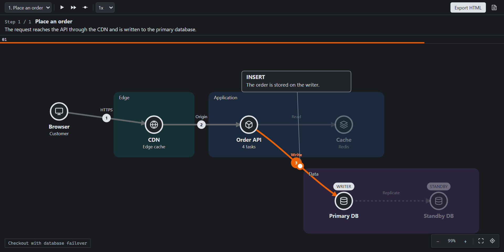

# DynamicArchitectViewer

Write architecture and screen-flow diagrams as text, then play them step by step. A VS Code extension for `.dav` files.



A static diagram struggles to show what happens over time. Requests, failovers and retries end up as a tangle of numbered arrows, or in a separate sequence diagram. Here, one diagram plays out in steps, while the structure stays in place.

```dav
dav 1
title "Checkout"

node browser "Browser" [icon: browser]
group backend "Backend" {
  node api "API" [icon: api]
  node db "Orders DB" [icon: database]
}
node psp "Payment provider" [icon: external]

browser --> api : "HTTPS"
api --> db : "SQL"
api --> psp : "Charge"

step "Place an order" {
  animate browser --> api : "POST /orders" [icon: file]
  animate api --> db : "Insert"
}

step "The payment provider fails" {
  state psp [badge: "503", color: red]
  animate api --> psp : "Charge" [icon: payment, color: red]
}
```

## Features

- **Automatic layout.** No coordinates to maintain, and small diffs in Git.
- **Live preview** that follows the editor, with playback, step-by-step navigation and speed control.
- **Language support:** highlighting, diagnostics with Quick Fixes, completions, a formatter that keeps comments, and an outline.
- **Standalone HTML export.** One file that works offline, with no external requests. The source can be extracted from it again.
- **AI-friendly.** A command copies a prompt that teaches the language to Claude Code, Copilot, ChatGPT and others.
- **Japanese and English UI**, following the VS Code display language.

## Install

The extension is in preview and not on the Marketplace yet. To build it from source, you need [Node.js](https://nodejs.org/) 26 and VS Code 1.96 or later:

```bash
npm ci
npm run package
code --install-extension apps/vscode/dist/dynamic-architect-viewer.vsix
```

Then open a `.dav` file, or run **DynamicArchitectViewer: New Diagram from Sample Template...** from the Command Palette, and press `Ctrl+Shift+V` (`⌘⇧V` on macOS) for the preview. More examples are in [`examples/`](examples/).

## Documentation

- [Language specification](docs/specification.md)
- [How diagrams are laid out](docs/layout.md)
- [Architecture](docs/architecture.md)
- [Contributing](CONTRIBUTING.md)

## License

[MIT](LICENSE)
