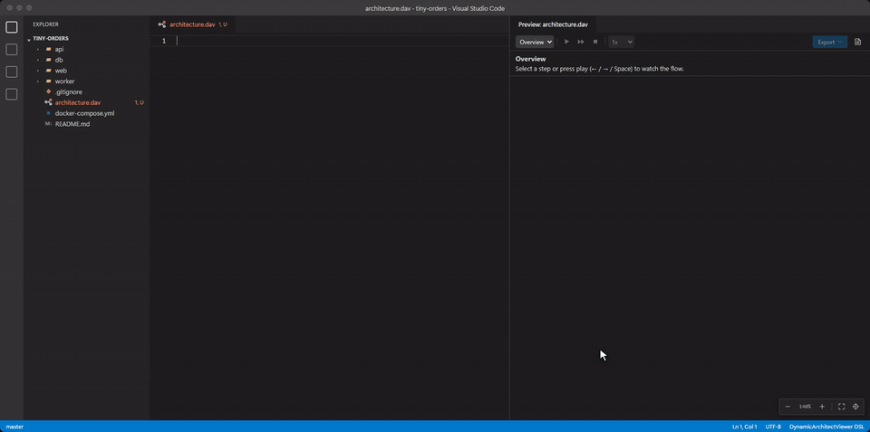

# DynamicArchitectViewer

Write architecture and screen-flow diagrams as text, then play them step by step. A VS Code extension for `.dav` files.


*This animation is an SVG file, exported by the extension from [`examples/01-infra-ha-failover.dav`](examples/01-infra-ha-failover.dav).*

A static diagram struggles to show what happens over time. Requests, failovers and retries end up as a tangle of numbered arrows, or in a separate sequence diagram. Here, one diagram plays out in steps, while the structure stays in place.

```dav
dav 1
title "Checkout"

node browser "Browser" [icon: browser]
group backend "Backend" {
  node api "API" [icon: api]
  node db "Orders DB" [icon: database]
}
node psp "Payment provider" [icon: external]

browser --> api : "HTTPS"
api --> db : "SQL"
api --> psp : "Charge"

step "Place an order" {
  animate browser --> api : "POST /orders" [icon: file]
  animate api --> db : "Insert"
}

step "The payment provider fails" {
  state psp [badge: "503", color: red]
  animate api --> psp : "Charge" [icon: payment, color: red]
}
```

## Features

- **Automatic layout.** No coordinates to maintain, and small diffs in Git.
- **Live preview** that follows the editor, with playback, step-by-step navigation and speed control.
- **Language support:** highlighting, diagnostics with Quick Fixes, completions, a formatter that keeps comments, and an outline.
- **Standalone HTML export.** One file with all steps that works offline, with no external requests. The source can be extracted from it again.
- **SVG export for READMEs.** An animated or still SVG covers every step or just the step in the preview, with the camera following the flow or keeping the whole diagram in view. It runs no script, so GitHub and GitLab play it as an image.
- **AI-friendly.** [Agent skills](#ai-agent-skills) let coding agents write, validate and explain `.dav` files, and a command copies a prompt for chat assistants.
- **Japanese and English UI**, following the VS Code display language.


*A screen flow, exported the same way from [`examples/02-screen-flow-checkout.dav`](examples/02-screen-flow-checkout.dav). [All examples](docs/examples.md) play like this.*

## Install

Install [DynamicArchitectViewer](https://marketplace.visualstudio.com/items?itemName=osg-junue.dynamic-architect-viewer) from the Visual Studio Marketplace. It needs VS Code 1.96 or later.

To build it from source, you also need [Node.js](https://nodejs.org/) 26:

```bash
npm ci
npm run package
code --install-extension apps/vscode/dist/dynamic-architect-viewer.vsix
```

Then open a `.dav` file, or run **DynamicArchitectViewer: New Diagram from Sample Template...** from the Command Palette, and press `Ctrl+Shift+V` (`⌘⇧V` on macOS) for the preview. More examples are in [`examples/`](examples/), and [docs/examples.md](docs/examples.md) plays each of them.

## AI agent skills

Two skills teach coding agents to work with `.dav` files. Their scripts need Node.js 18 or later.

| Skill | For | Its script |
| :--- | :--- | :--- |
| [`dav-diagrams`](skills/dav-diagrams/SKILL.md) | Writing and changing diagrams: the language, how layout works, how to structure steps, and how much detail a diagram needs | `dav-check` runs the parser and formatter of the editor, and with `--detail` also reports missing descriptions and code and text too long to be shown in full, and describes the layout |
| [`dav-reading`](skills/dav-reading/SKILL.md) | Reading diagrams: explaining the architecture and the data flows a `.dav` file describes | `dav-outline` prints what the file says, with every reference resolved and the packets of each step in order |

**From VS Code:** run **DynamicArchitectViewer: Install AI Agent Skill...** from the Command Palette, then choose Claude Code, GitHub Copilot or Codex, and either the workspace or all projects. It installs both skills.



**As a Claude Code plugin:**

```bash
claude plugin marketplace add Osg-Junue/DynamicArchitectViewer
claude plugin install dynamic-architect-viewer@osg-junue
```

**For other agents** that support [Agent Skills](https://agentskills.io/), with the third-party [`skills`](https://github.com/vercel-labs/skills) CLI:

```bash
npx skills add Osg-Junue/DynamicArchitectViewer --skill dav-diagrams
npx skills add Osg-Junue/DynamicArchitectViewer --skill dav-reading
```

Then ask your agent as usual, such as "Diagram this repository's login flow in `auth.dav`" or "Explain how an order flows through `checkout.dav`".

## Documentation

- [Examples](docs/examples.md)
- [Language specification](docs/specification.md)
- [How diagrams are laid out](docs/layout.md)
- [Architecture](docs/architecture.md)
- [Contributing](CONTRIBUTING.md)

## License

[MIT](LICENSE)
