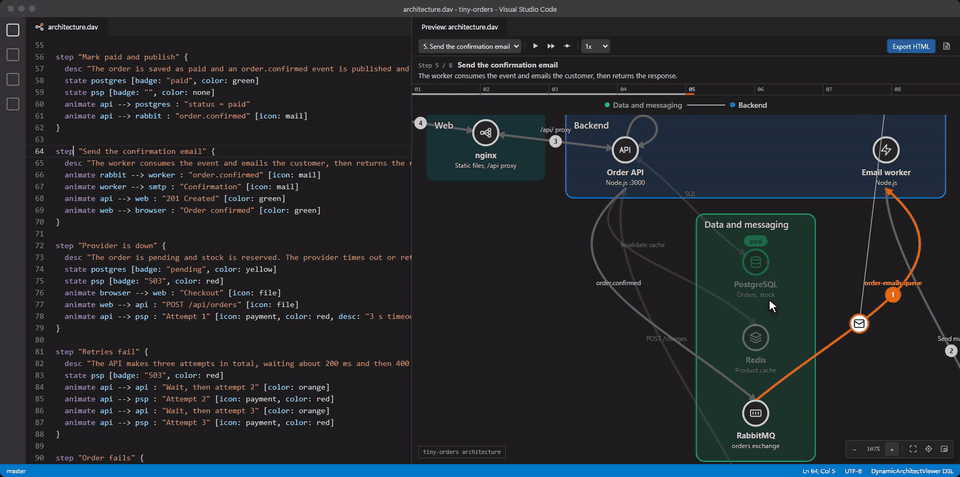

# DynamicArchitectViewer

Write architecture and screen-flow diagrams as text, then play them step by step. A VS Code extension for `.dav` files.


A static diagram struggles to show what happens over time. Requests, failovers and retries end up as a tangle of numbered arrows, or in a separate sequence diagram. Here, one diagram plays out in steps, while the structure stays in place.

```dav
dav 1
title "Checkout"

node browser "Browser" [icon: browser]
group backend "Backend" {
  node api "API" [icon: api]
  node db "Orders DB" [icon: database]
}
node psp "Payment provider" [icon: external]

browser --> api : "HTTPS"
api --> db : "SQL"
api --> psp : "Charge"

step "Place an order" {
  animate browser --> api : "POST /orders" [icon: file]
  animate api --> db : "Insert"
}

step "The payment provider fails" {
  state psp [badge: "503", color: red]
  animate api --> psp : "Charge" [icon: payment, color: red]
}
```

## Features

- **Automatic layout.** No coordinates to maintain, and small diffs in Git.
- **Live preview** that follows the editor, with playback, step-by-step navigation and speed control.
- **Language support:** highlighting, diagnostics with Quick Fixes, completions, a formatter that keeps comments, and an outline.
- **Standalone HTML export.** One file that works offline, with no external requests. The source can be extracted from it again.
- **SVG export for READMEs.** An animated SVG plays the steps with the camera following the flow. It runs no script, so GitHub and GitLab play it as an image.
- **AI-friendly.** An [agent skill](#ai-agent-skill) lets coding agents write and validate `.dav` files, and a command copies a prompt for chat assistants.
- **Japanese and English UI**, following the VS Code display language.



## Install

Install [DynamicArchitectViewer](https://marketplace.visualstudio.com/items?itemName=osg-junue.dynamic-architect-viewer) from the Visual Studio Marketplace. It is in preview and needs VS Code 1.96 or later.

To build it from source, you also need [Node.js](https://nodejs.org/) 26:

```bash
npm ci
npm run package
code --install-extension apps/vscode/dist/dynamic-architect-viewer.vsix
```

Then open a `.dav` file, or run **DynamicArchitectViewer: New Diagram from Sample Template...** from the Command Palette, and press `Ctrl+Shift+V` (`⌘⇧V` on macOS) for the preview. More examples are in [`examples/`](examples/).

## AI agent skill

The [`dav-diagrams`](skills/dav-diagrams/SKILL.md) skill teaches coding agents the language, how layout works and how to structure steps. Its bundled checker runs the same parser and formatter as the editor, so an agent can fix its own mistakes. The checker needs Node.js 18 or later.

**From VS Code:** run **DynamicArchitectViewer: Install AI Agent Skill...** from the Command Palette, then choose Claude Code, GitHub Copilot or Codex, and either the workspace or all projects.


**As a Claude Code plugin:**

```bash
claude plugin marketplace add Osg-Junue/DynamicArchitectViewer
claude plugin install dynamic-architect-viewer@osg-junue
```

**For other agents** that support [Agent Skills](https://agentskills.io/), with the third-party [`skills`](https://github.com/vercel-labs/skills) CLI:

```bash
npx skills add Osg-Junue/DynamicArchitectViewer --skill dav-diagrams
```

Then ask your agent for a diagram as usual, such as "Diagram this repository's login flow in `auth.dav`".

## Documentation

- [Language specification](docs/specification.md)
- [How diagrams are laid out](docs/layout.md)
- [Architecture](docs/architecture.md)
- [Contributing](CONTRIBUTING.md)

## License

[MIT](LICENSE)
