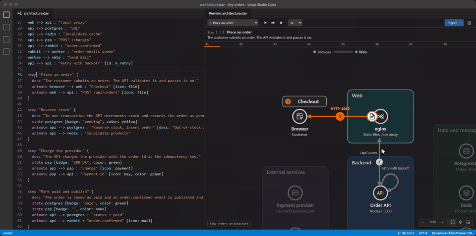

# DynamicArchitectViewer

Write architecture and screen-flow diagrams as text, then play them step by step.



A static diagram struggles to show what happens over time. Requests, failovers and retries end up as a tangle of numbered arrows, or in a separate sequence diagram. Here, one diagram plays out in steps, while the structure stays in place.

```dav
dav 1
title "Checkout"

node browser "Browser" [icon: browser]
group backend "Backend" {
  node api "API" [icon: api]
  node db "Orders DB" [icon: database]
}
node psp "Payment provider" [icon: external]

browser --> api : "HTTPS"
api --> db : "SQL"
api --> psp : "Charge"

step "Place an order" {
  animate browser --> api : "POST /orders" [icon: file]
  animate api --> db : "Insert"
}

step "The payment provider fails" {
  state psp [badge: "503", color: red]
  animate api --> psp : "Charge" [icon: payment, color: red]
}
```

## Getting started

1. Run **DynamicArchitectViewer: New Diagram from Sample Template...** from the Command Palette, or open a `.dav` file.
2. Press `Ctrl+Shift+V` (`⌘⇧V` on macOS) to open the preview beside the editor.
3. Play the steps from the toolbar, or move between them with `←` and `→`.

The Export menu in the preview toolbar saves the diagram as a standalone HTML file, an animated SVG (with the camera following the flow, or on the whole diagram) or a still SVG, of every step or of the step the preview shows. The documentation button next to it opens a guide to the language, with live examples.

## Features

- **Automatic layout.** No coordinates to maintain. [What to write to get the arrangement you want](https://github.com/Osg-Junue/DynamicArchitectViewer/blob/HEAD/docs/layout.md).
- **Live preview** that follows the editor. Move the cursor to highlight an element, and double-click an element to jump to its source.
- **Playback** with step selection, play all, adjustable speed, and a still view of each step.
- **Language support:** highlighting, diagnostics with Quick Fixes, completions for names, attributes and the 42 built-in icons, a formatter that keeps comments, and an outline.
- **Standalone HTML export.** One file that works offline, with a strict Content Security Policy. The source can be extracted from it again.
- **SVG export for READMEs.** An animated SVG plays every step with the camera following the flow or kept on the whole diagram, and needs no script, so it plays as an image on GitHub and GitLab. A still SVG shows the whole diagram.
- **AI-friendly.** Install an agent skill that lets Claude Code, GitHub Copilot and Codex write and validate `.dav` files, or copy a prompt for chat assistants.
- **Japanese and English UI**, following the VS Code display language.

## Commands

| Command | Shortcut |
| :--- | :--- |
| Open Canvas Preview to the Side | `Ctrl+Shift+V` / `⌘⇧V` |
| Export Standalone HTML | |
| Export SVG Image... | |
| Extract DSL from Standalone HTML... | |
| New Diagram from Sample Template... | |
| Copy AI Prompt Template (DSL v1 Spec) | |
| Install AI Agent Skill... | |

## Learn more

- [AI agent skill](https://github.com/Osg-Junue/DynamicArchitectViewer#ai-agent-skill)
- [Language specification](https://github.com/Osg-Junue/DynamicArchitectViewer/blob/HEAD/docs/specification.md)
- [Examples](https://github.com/Osg-Junue/DynamicArchitectViewer/tree/HEAD/examples)
- [Report an issue](https://github.com/Osg-Junue/DynamicArchitectViewer/issues)
