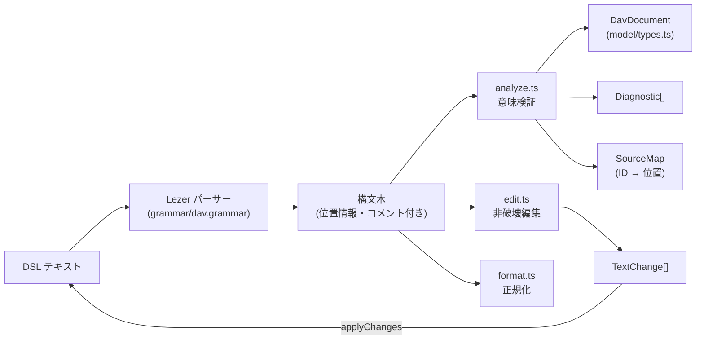

# DSL コア設計 (DSL Core)

`apps/web/src/dsl/` と `apps/web/src/model/` の設計です。DSL の言語仕様は [dsl-v1.md](../03-specification/dsl-v1.md) を参照してください。

## 1. 位置づけ

製品原則「DSL が唯一の正」を実装する層です。GUI を含むすべての編集は、この層の編集 API が返す**テキスト差分**として DSL に反映されます。DOM・React に依存しません（[architecture.test.ts](../../apps/web/src/__tests__/architecture.test.ts) で依存方向を検査）。



## 2. モジュール

| ファイル | 役割 |
| :--- | :--- |
| `model/types.ts` | `DavDocument` 等の純粋データ型。位置情報を持たない |
| `model/icons.ts` | アイコンのカテゴリ・既定色（SVG は描画層の責務） |
| `dsl/grammar/dav.grammar` | Lezer 文法。`@lezer/generator/rollup` により Vite / Vitest がビルド時に生成（生成物はコミットしない） |
| `dsl/syntax.ts` | 構文木の走査、文字列のエスケープ/アンエスケープ |
| `dsl/schema.ts` | 属性スキーマ（対象ごとの属性名と型）、識別子・色の検証 |
| `dsl/analyze.ts` | `parse()`: 構文エラー収集、モデル構築、ID 登録、参照解決、属性検証 |
| `dsl/diagnostics.ts` | 診断コードと日英メッセージ（`formatDiagnostic(d, locale)`） |
| `dsl/edit.ts` | 非破壊編集 API |
| `dsl/format.ts` | 正規フォーマッタ |
| `dsl/index.ts` | 公開 API |

## 3. 設計判断

| 判断 | 内容 | 理由 |
| :--- | :--- | :--- |
| Lezer | 文法を宣言的に定義し、エラー回復付き LR パーサーを生成 | M3 で CodeMirror 6 のハイライト・折りたたみに同じ文法を再利用できる |
| 改行非依存の文法 | 文はトークン列だけで区切れる | `{` の改行位置などで構文エラーにならない |
| 診断はコード＋引数 | 文字列でなく `code` と `args` を保持 | UI 言語の切替（M4） |
| 不正値は省略して続行 | 不正な属性は診断を出しモデルには含めない。他の要素は通常どおり構築 | 編集中の一時的なエラーで図全体が消えない |
| SourceMap の分離 | モデルに行番号等を持たせない | 出力 HTML にエディタ内部情報が混入しない |
| 編集はテキスト差分 | `TextChange { from, to, insert }[]` を返す | CodeMirror のトランザクションと Undo 履歴にそのまま載る |
| 書式を壊さない | 編集 API は対象トークンのみ置換・挿入し、行削除は単独行の場合のみ行全体を対象にする | コメント・空行・作者の並び順を保持 |
| 連鎖削除 | `removeElement` は依存するエッジ・`focus`・`state`・`animate` も削除 | 削除後に未定義参照の診断が残らない |

## 4. 公開 API

```ts
parse(text): { document, diagnostics, sourceMap }
format(text): string                    // 構文エラーがあれば原文を返す
formatDiagnostic(diagnostic, 'ja' | 'en'): string

// 編集（すべて TextChange[] を返す。不正な入力は EditError を投げる）
setPlacement(text, id, { pos?, size? })            // null で削除
setAttribute(text, id, key, value | undefined)     // undefined で削除
setLabel(text, id, label | undefined) / setStepTitle(text, index, title)
addNode / addGroup(text, { id, label?, attrs?, parentId?, pos?, size? })
addEdge(text, { from, to, arrow?, label?, attrs? })
removeElement(text, id)
renameId(text, oldId, newId)
addStep(text, spec, index?) / removeStep / moveStep(text, from, to)
insertStepStatement / replaceStepStatement / removeStepStatement
applyChanges(text, changes): string
```

## 5. テスト

| ファイル | 内容 |
| :--- | :--- |
| `dsl/__tests__/parse.test.ts` | サンプル全件の診断ゼロ、モデル構築、全診断コードのテーブルテスト |
| `dsl/__tests__/format.test.ts` | 正規化、コメント・空行保持、冪等性 |
| `dsl/__tests__/edit.test.ts` | 各編集操作の出力、コメント保持、CRLF 保持、不正入力の拒否 |
| `dsl/__tests__/property.test.ts` | fast-check: ランダムな編集列で常に診断ゼロ・コメント保持／フォーマットの冪等性と意味保存／ラベルのエスケープ往復／任意入力で例外なし |
| `__tests__/architecture.test.ts` | `model` → なし、`dsl` → `model` の依存方向 |
