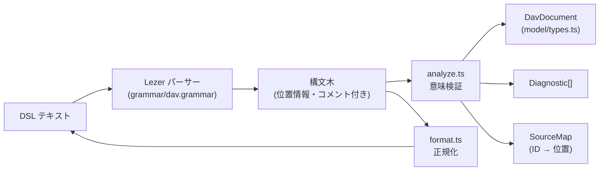

# DSL コア設計 (DSL Core)

`apps/vscode/src/dsl/` と `apps/vscode/src/model/` の設計です。DSL の言語仕様は [dsl-v1.md](../03-specification/dsl-v1.md) を参照してください。

## 1. 位置づけ

製品原則「DSL が唯一の正（コード記述のみ・100%自動レイアウト）」を実装する層です。DOM や外部 UI フレームワークに一切依存しません（[architecture.test.ts](../../apps/vscode/src/__tests__/architecture.test.ts) で依存方向を検査）。



## 2. モジュール

| ファイル | 役割 |
| :--- | :--- |
| `model/types.ts` | `DavDocument` 等の純粋データ型。座標・位置情報を持たない |
| `model/icons.ts` | 38種の内蔵アイコンのカテゴリ・用途説明（SVG は描画層の責務） |
| `dsl/grammar/dav.grammar` | Lezer 文法。`@lezer/generator` によりビルド時に生成 |
| `dsl/syntax.ts` | 構文木の走査、文字列のエスケープ/アンエスケープ |
| `dsl/schema.ts` | 属性スキーマ（対象ごとの属性名と型）、識別子・色の検証 |
| `dsl/analyze.ts` | `parse()`: 構文エラー収集、モデル構築、ID 登録、参照解決、属性検証。`findAtOffset()`: カーソル位置逆引き |
| `dsl/diagnostics.ts` | 診断コードと日英メッセージ（`formatDiagnostic(d, locale)`） |
| `dsl/complete.ts` | コンテキスト認識オートコンプリート候補計算 |
| `dsl/format.ts` | コメント・空行を保持する正規フォーマッタ |
| `dsl/index.ts` | 公開 API |

## 3. 設計判断

| 判断 | 内容 | 理由 |
| :--- | :--- | :--- |
| Lezer | 文法を宣言的に定義し、エラー回復付き LR パーサーを生成 | 構文エラー回復と正確なトークン位置情報を高速に取得できる |
| 手動座標の廃止 | `@pos` / `@size` を文法・モデルから排除 | コード記述のみに統一し、仕様と実装を大幅に軽量化 |
| 改行非依存の文法 | 文はトークン列だけで区切れる | `{` の改行位置などで構文エラーにならない |
| 診断はコード＋引数 | 文字列でなく `code` と `args` を保持 | 言語別のメッセージを生成できる（エディタの診断は英語、ドキュメント画面は日英） |
| 不正値は省略して続行 | 不正な属性は診断を出しモデルには含めない。他の要素は通常どおり構築 | 編集中の一時的なエラーで図全体が消えない |
| SourceMap の分離 | モデルに行番号等を持たせない | 出力 HTML にエディタ内部情報が混入しない |

## 4. 公開 API

```ts
parse(text): { document, diagnostics, sourceMap }
format(text): string                    // 構文エラーがあれば原文を返す
formatDiagnostic(diagnostic, 'ja' | 'en'): string
computeCompletions(text, offset, includeSnippets?): DslCompletionList | null
findAtOffset(sourceMap, offset): { elementId: string | null; stepIndex: number | null }
```

## 5. テスト

| ファイル | 内容 |
| :--- | :--- |
| `dsl/__tests__/parse.test.ts` | サンプル全件の診断ゼロ、モデル構築、全診断コードのテーブルテスト |
| `dsl/__tests__/format.test.ts` | 正規化、コメント・空行保持、冪等性 |
| `dsl/__tests__/property.test.ts` | fast-check: フォーマットの冪等性と意味保存／ラベルのエスケープ往復／任意入力で例外なし |
| `__tests__/architecture.test.ts` | `model` → なし、`dsl` → `model` の依存方向と React 不使用の検証 |
