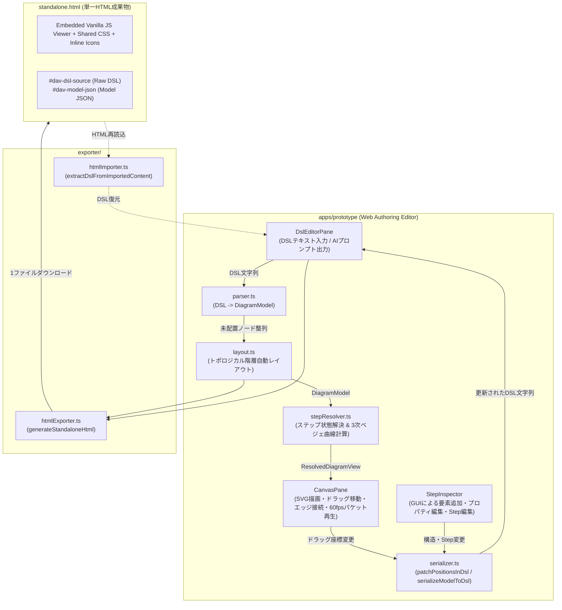

# システムアーキテクチャ概要 (System Overview)

## 1. 技術スタックとクライアントサイド完結設計

本システムは、サーバーサイドの描画・変換処理を一切持たず、すべてのパース・レイアウト計算・アニメーション描画・HTMLバンドル生成を**ユーザーのブラウザ上（完全クライアントサイド）**で実行するSPAとして設計されています。

- **ランタイム環境**: Node.js `v26.13.0` (Lithium)
- **実装言語**: TypeScript `v7.0.2` (`target: "ESNext"`)
- **ビルドツール / テスト**: Vite `v8.3.6` / Vitest `v5.1.0`
- **エディタUI**: React `v19.3.1`
- **スタンドアロンViewerランタイム**: フレームワーク非依存のVanilla JS + インラインSVG + CSSアニメーション（単一HTML出力時のファイルサイズ最小化と `file://` 動作保証のため）

---

## 2. コンポーネント構成とデータフロー

---

## 3. 主要サブシステムの設計詳細

### 3.1 オプショナル座標とトポロジカル自動レイアウト (`src/core/layout.ts`)

- AIエージェントがDSLを生成する際、ピクセル座標（`@pos(x, y)`）の指定は不要です。
- パーサーがDSLを読み込んだ直後、エッジの接続方向（`from --> to`）から有向グラフの入次数と最長経路ランク（列インデックス）を計算し、左から右へ階層的にノードを自動配置します。
- グループ枠（`group`）についても、`@pos` / `@size` が省略されている場合は所属ノード群のバウンディングボックスを自動計算し、適切なパディングを持たせて囲みます。

### 3.2 非破壊な双方向同期 (`src/core/serializer.ts`)

GUI操作からDSLテキストへの反映には、操作種別に応じて2段階のシリアライズ方式を使い分けています。

1. **インプレース座標パッチ (`patchPositionsInDsl`)**:
   - キャンバス上でノードやグループをマウスドラッグした際、DSL全文を再生成するのではなく、該当する `node <id>` / `group <id>` の行のみを正規表現で特定し、`@pos(x, y)` および `@size(w, h)` トークンのみを挿入・置換します。
   - これにより、ユーザーがDSL内に書いたコメント（`// ...`）や空行・インデント構造を一切壊さずにGUIドラッグ操作を反映できます。
2. **構造シリアライズ (`serializeModelToDsl`)**:
   - 右ペインのGUIインスペクタから新規ノード・グループ・エッジ・ステップの追加や削除を行った場合は、更新された `DiagramModel` から整形されたDSLを生成します。

### 3.3 ステップ状態解決とマルチホップ・ベジェ曲線アニメーション (`src/viewer/stepResolver.ts`)

- **決定論的なステップ解決**:
  - 各ステップの状態（`states`、フォーカス `focusIds`、アニメーション `animations`）は、ベースモデルに対してステップ単位で純粋関数として解決されます。これにより、ステップの前後移動や任意のステップへのジャンプを行っても状態の不整合が発生しません。
- **3次ベジェ曲線補間によるパケット描画**:
  - 接続元ノードと接続先ノードの相対位置（水平優勢か垂直優勢か）から最適なポート座標と制御点（$P_0, P_1, P_2, P_3$）を算出し、SVGの `<path>` と同一の3次ベジェ曲線式 $B(t) = (1-t)^3 P_0 + 3(1-t)^2 t P_1 + 3(1-t) t^2 P_2 + t^3 P_3$ を用いて、`requestAnimationFrame` ごとにパケットとラベルピルの正確な座標を計算します。
  - ブラウザ固有のSMIL（`<animateMotion>`）制限に依存しないため、あらゆるブラウザ環境で同一のアニメーション品質を保証します。
