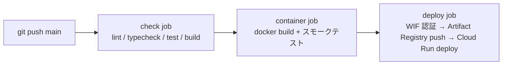

# Cloud Run デプロイ手順 (Operations)

本番環境は Cloud Run 上の静的配信コンテナ（nginx-unprivileged）です。`main` への push で GitHub Actions がビルド・デプロイします。



| ファイル                                                                       | 役割                                                 |
| :----------------------------------------------------------------------------- | :--------------------------------------------------- |
| [Dockerfile](../../Dockerfile)                                                 | Node でビルド → nginx-unprivileged で `dist/` を配信 |
| [deploy/nginx/default.conf](../../deploy/nginx/default.conf)                   | 8080 待受、SPA フォールバック、キャッシュ制御、gzip  |
| [deploy/nginx/security-headers.conf](../../deploy/nginx/security-headers.conf) | CSP 等のセキュリティヘッダ                           |
| [.github/workflows/ci.yml](../../.github/workflows/ci.yml)                     | CI とデプロイ                                        |

---

## 1. 初回セットアップ（手作業・1回のみ）

Cloud Shell で実行することを想定しています。先頭の変数を自分の環境に合わせて書き換えてください。

```bash
PROJECT_ID="your-project-id"
REGION="asia-northeast1"
AR_REPO="dav"
SERVICE="dav-web"
GITHUB_REPO="OWNER/REPO"          # 例: O10J/DynamicArchitectViewer

gcloud config set project "$PROJECT_ID"
PROJECT_NUMBER="$(gcloud projects describe "$PROJECT_ID" --format='value(projectNumber)')"

# 1) API 有効化
gcloud services enable \
  run.googleapis.com \
  artifactregistry.googleapis.com \
  iamcredentials.googleapis.com \
  sts.googleapis.com

# 2) Artifact Registry
gcloud artifacts repositories create "$AR_REPO" \
  --repository-format=docker --location="$REGION"

# 3) サービスアカウント
#    - dav-runtime : Cloud Run 実行用（権限なし。静的配信のみのため）
#    - github-deployer : GitHub Actions からのデプロイ用
gcloud iam service-accounts create dav-runtime --display-name="DAV Cloud Run runtime"
gcloud iam service-accounts create github-deployer --display-name="DAV GitHub deployer"

RUNTIME_SA="dav-runtime@${PROJECT_ID}.iam.gserviceaccount.com"
DEPLOY_SA="github-deployer@${PROJECT_ID}.iam.gserviceaccount.com"

gcloud projects add-iam-policy-binding "$PROJECT_ID" \
  --member="serviceAccount:${DEPLOY_SA}" --role="roles/run.admin"
gcloud artifacts repositories add-iam-policy-binding "$AR_REPO" --location="$REGION" \
  --member="serviceAccount:${DEPLOY_SA}" --role="roles/artifactregistry.writer"
gcloud iam service-accounts add-iam-policy-binding "$RUNTIME_SA" \
  --member="serviceAccount:${DEPLOY_SA}" --role="roles/iam.serviceAccountUser"

# 4) Workload Identity Federation（サービスアカウントキー不要）
gcloud iam workload-identity-pools create github \
  --location=global --display-name="GitHub Actions"

gcloud iam workload-identity-pools providers create-oidc github \
  --location=global --workload-identity-pool=github \
  --issuer-uri="https://token.actions.githubusercontent.com" \
  --attribute-mapping="google.subject=assertion.sub,attribute.repository=assertion.repository,attribute.ref=assertion.ref" \
  --attribute-condition="assertion.repository=='${GITHUB_REPO}' && assertion.ref=='refs/heads/main'"

gcloud iam service-accounts add-iam-policy-binding "$DEPLOY_SA" \
  --role="roles/iam.workloadIdentityUser" \
  --member="principalSet://iam.googleapis.com/projects/${PROJECT_NUMBER}/locations/global/workloadIdentityPools/github/attribute.repository/${GITHUB_REPO}"

# 5) GitHub に設定する値を表示
echo "GCP_PROJECT_ID=${PROJECT_ID}"
echo "GCP_REGION=${REGION}"
echo "GCP_AR_REPOSITORY=${AR_REPO}"
echo "CLOUD_RUN_SERVICE=${SERVICE}"
echo "GCP_DEPLOY_SA=${DEPLOY_SA}"
echo "GCP_RUNTIME_SA=${RUNTIME_SA}"
echo "GCP_WIF_PROVIDER=projects/${PROJECT_NUMBER}/locations/global/workloadIdentityPools/github/providers/github"
```

### GitHub 側の設定

1. リポジトリの **Settings → Environments** で `production` 環境を作成（必要なら承認者を設定）
2. **Settings → Secrets and variables → Actions → Variables** に上記7つを登録
   - いずれも秘密情報ではないため Variables で可（WIF によりキーは存在しない）
3. `GCP_PROJECT_ID` が未設定の間は `deploy` ジョブはスキップされ、CI のみ動きます

### コスト防御（必須）

- **Billing → Budgets & alerts** で月額予算（例: 1,000円）とアラート閾値（50% / 90% / 100%）を設定
- `--max-instances=2` で同時インスタンス数を制限済み（[ci.yml](../../.github/workflows/ci.yml) の `flags`）

> [!WARNING]
> 組織ポリシー「ドメインで制限された共有（`iam.allowedPolicyMemberDomains`）」が有効なプロジェクトでは `--allow-unauthenticated`（`allUsers` への公開）が拒否されます。個人プロジェクトでは通常問題ありません。

---

## 2. 運用

| 操作         | 方法                                                                                                                                                                                     |
| :----------- | :--------------------------------------------------------------------------------------------------------------------------------------------------------------------------------------- |
| デプロイ     | `main` に push（または Actions から `workflow_dispatch`）                                                                                                                                |
| ロールバック | Cloud Run コンソールの「リビジョン」から旧リビジョンへトラフィックを 100% 切替、または `gcloud run services update-traffic dav-web --region=asia-northeast1 --to-revisions=REVISION=100` |
| ログ         | Cloud Run コンソール → ログ                                                                                                                                                              |
| 依存更新     | Dependabot（npm / GitHub Actions / Docker ベースイメージ、週次）                                                                                                                         |

## 3. ローカル確認

Docker がある環境では以下で本番同等の配信を確認できます。

```bash
docker build -t dav-web .
docker run --rm -p 8080:8080 dav-web
# → http://localhost:8080
```
