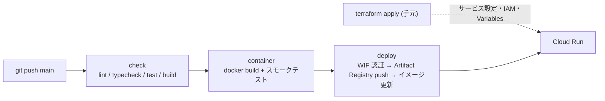

# Cloud Run デプロイ・インフラ運用 (Operations)

本番環境は Cloud Run 上の静的配信コンテナ（nginx-unprivileged）です。インフラは **Terraform**（[infra/terraform](../../infra/terraform)）で管理し、アプリのデプロイは `main` への push で GitHub Actions が行います。

## 1. 責務分担

| 対象 | 管理方法 |
| :--- | :--- |
| GCP プロジェクト、tfstate 用バケット | ブートストラップ（gcloud、1回のみ。§4） |
| API 有効化、Artifact Registry（古いイメージの自動削除）、サービスアカウント、IAM、Workload Identity Federation、Cloud Run サービス設定（スケーリング・CPU/メモリ・実行SA・公開設定）、予算アラート | Terraform（`main.tf`） |
| GitHub `production` 環境、Actions Variables | Terraform（`github.tf`） |
| コンテナイメージ（Cloud Run のリビジョン） | GitHub Actions（[ci.yml](../../.github/workflows/ci.yml)） |

> [!IMPORTANT]
> Cloud Run の設定をコンソールや `gcloud run services update` で変更しないでください。次回の `terraform apply` で戻されます。Terraform 側はイメージとデプロイ時に付くラベルのみ `ignore_changes` しています。



## 2. 現在の環境

| 項目 | 値 |
| :--- | :--- |
| GCP プロジェクト | `dav-web-prod-cdaofb` |
| リージョン | `asia-northeast1` |
| Cloud Run サービス | `dav-web`（min 0 / max 2、1 vCPU / 256Mi） |
| tfstate | `gs://dav-web-prod-cdaofb-tfstate/prod`（バージョニング有効） |
| 予算 | 月 1,000 円（50% / 90% / 100% / 予測100% で請求先管理者にメール） |

## 3. Terraform の実行

[tf.ps1](../../infra/terraform/tf.ps1) は `gcloud auth print-access-token` と `gh auth token` から短命トークンを取得して Terraform を実行するラッパーです（鍵ファイル・ADC 不要）。

```powershell
./infra/terraform/tf.ps1 init       # 初回 / プロバイダ更新時
./infra/terraform/tf.ps1 plan
./infra/terraform/tf.ps1 apply
```

前提:
- `gcloud auth login` 済みで、プロジェクトのオーナー権限と請求先アカウントの予算編集権限を持つこと
- `gh auth login` 済みで、リポジトリの管理権限を持つこと
- Terraform 実行ファイルの場所が異なる場合は環境変数 `TERRAFORM_EXE` で指定

## 4. ブートストラップ（実施済み・再構築時のみ）

Terraform の state を置くバケットは Terraform 自身では作れないため、gcloud で作成しています。

```powershell
$p = "dav-web-prod-cdaofb"
gcloud projects create $p --name="DynamicArchitectViewer"
gcloud billing projects link $p --billing-account=015A54-C804F8-76324A
gcloud services enable serviceusage.googleapis.com cloudresourcemanager.googleapis.com storage.googleapis.com iam.googleapis.com cloudbilling.googleapis.com billingbudgets.googleapis.com --project=$p
gcloud storage buckets create "gs://$p-tfstate" --project=$p --location=asia-northeast1 --uniform-bucket-level-access --public-access-prevention
gcloud storage buckets update "gs://$p-tfstate" --versioning
```

その後 `terraform.tfvars` と `backend.hcl` を更新して §3 を実行します。

## 5. 運用

| 操作 | 方法 |
| :--- | :--- |
| デプロイ | `main` に push（または Actions の `workflow_dispatch`） |
| ロールバック | Cloud Run コンソールの「リビジョン」で旧リビジョンにトラフィックを 100% 切替。または `gcloud run services update-traffic dav-web --region=asia-northeast1 --to-revisions=REVISION=100` |
| スケール上限・メモリ変更 | `variables.tf` / `main.tf` を変更して `terraform apply` |
| ログ | Cloud Run コンソール → ログ |
| 依存更新 | Dependabot（npm / GitHub Actions / Docker ベースイメージ、週次） |

## 6. ローカル確認

Docker がある環境では以下で本番同等の配信を確認できます。

```bash
docker build -t dav-web .
docker run --rm -p 8080:8080 dav-web
# → http://localhost:8080
```
