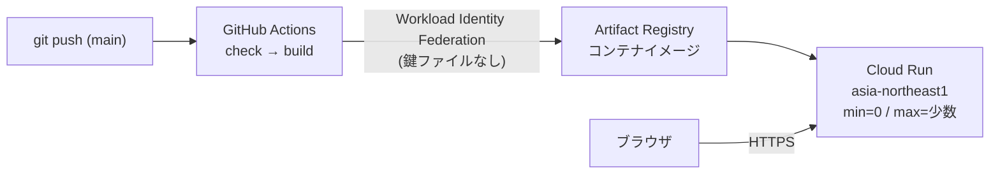

# DynamicArchitectViewer 製品化方針 v2

> [!NOTE]
> 現在の提供形態は **VS Code 拡張機能**（`apps/vscode`）です。Cloud Run、`apps/web`、IndexedDB 保存、M0 の手順など Web アプリを前提とする記述は、当初計画の記録として残しています。

## 前提（確定）

| 項目       | 決定                       | 方針への影響                                                                                     |
| :--------- | :------------------------- | :----------------------------------------------------------------------------------------------- |
| 提供形態   | **VS Code 拡張機能**（当初計画: Webアプリ / Cloud Run） | Webview でプレビューし、`.vsix` として配布。サーバー側ロジック・DB・アカウントなし |
| 位置づけ   | 個人アプリ                 | 収益化・課金・チーム機能は対象外。運用コストゼロを維持                                           |
| 利用者     | 誰でも                     | UIは日英対応、オンボーディング（サンプル・ヘルプ）が必須                                         |
| DSL互換    | 破壊的変更OK               | DSL v1をゼロベースで設計。プロトタイプ互換コードは書かない                                       |
| 体制・期間 | 1人・期限なし              | **重いプロセスは入れない**。小さく完結するマイルストーン単位で、常に動く状態を保つ               |

---

## 1. 現状の課題（調査結果の要約）

| 優先 | 課題                                     | 根拠                                                                                                            |
| :--- | :--------------------------------------- | :-------------------------------------------------------------------------------------------------------------- |
| 高   | 描画ロジックが3重実装                    | `stepResolver.ts` / `CanvasPane.tsx` / `htmlExporter.ts` 内のES5文字列（`computeBezier`, `resolveCurrentView`） |
| 高   | GUI構造編集でDSLのコメント消失・座標固定 | 構造変更時は `serializeModelToDsl` で全文再生成                                                                 |
| 高   | DSL仕様が正規表現に埋没                  | エスケープ不可、IDの出現順依存、未定義参照・重複IDが無警告、不正値の黙殺                                        |
| 高   | 開発基盤なし                             | Git管理なし、CI・Lintなし、テスト5件                                                                            |
| 中   | 出力HTMLのインジェクション余地           | `color` 未検証、一部style属性が未エスケープで `innerHTML` へ                                                    |
| 中   | ファイル形式に版数なし、内部状態が混入   | 埋め込みJSONに `diagnostics` / `line` が含まれる                                                                |
| 中   | エディタ                                 | Undo/Redo・自動保存なし、`CanvasPane.tsx` 31KBに責務集中                                                        |
| 低   | レイアウト                               | 交差最小化なし                                                                                                  |

---

## 2. 製品原則

1. **DSLが唯一の正** — GUI操作は「DSLへの最小差分編集」。全文再生成はフォーマッタのみ。
2. **描画実装は1つ** — エディタのキャンバスと出力HTMLは同じ描画コードを使う。
3. **出力HTMLは自己完結・永久閲覧可能** — 外部依存ゼロ、ランタイムにサイズ予算（目安 gzip 50KB）。
4. **AIで書きやすい** — 座標なしで書ける、エラーが具体的。
5. **入力は信頼しない** — 他人から受け取ったHTML/DSLを開いても安全。
6. **1人で保守できる規模** — 依存とパッケージ数は最小限。

---

## 3. 構成（1人向けに簡素化）

パッケージを細かく分けず、**1アプリ内のディレクトリ境界 + ESLintの import 制約**で依存方向を守る。ランタイムだけ別エントリでビルドする。

```text
apps/web/src/
├── dsl/        # lexer, parser(CST+位置情報), validator, edit API, formatter  ← DOM非依存
├── model/      # 型定義、ファイル形式(version付き)
├── layout/     # 自動レイアウト
├── scene/      # ステップ解決 + SVG描画記述の生成 ← DOM非依存。エディタ/ランタイム共通
├── runtime/    # 出力HTML用プレーヤー（別エントリでIIFEビルド）
├── exporter/   # 単一HTML生成・取り込み（ビルド済みruntimeを ?raw で埋め込み）
├── editor/     # React UI
└── i18n/
```

依存方向: `dsl, model → layout → scene → runtime / editor`、`exporter → dsl, model, runtime`。`scene` 以下はReactを知らない。

### 主要な技術判断

| 判断                 | 推奨                                                                       | 理由 / トレードオフ                                                                                                                                                      |
| :------------------- | :------------------------------------------------------------------------- | :----------------------------------------------------------------------------------------------------------------------------------------------------------------------- |
| パーサー             | **Lezer**                                                                  | CodeMirror 6のハイライト・構文エラー表示と文法定義を共有でき、1人で2つの文法を保守せずに済む。エラー回復・位置情報も標準装備。手書きより学習コストはあるが総工数は小さい |
| エディタのテキスト部 | CodeMirror 6                                                               | Lezerと統合済み、軽量                                                                                                                                                    |
| 非破壊編集           | 構文木の位置情報に基づくテキスト差分編集                                   | 現行の正規表現パッチを置換                                                                                                                                               |
| Undo/Redo            | DSLテキストの履歴として実装                                                | DSLが唯一の正なので、テキスト変更履歴だけで全操作が戻せる。実装が最も単純                                                                                                |
| 保存                 | IndexedDB自動保存 + File System Access API（非対応ブラウザはダウンロード） | サーバー不要                                                                                                                                                             |
| レイアウト           | まず現行改善。不足ならelkjsをエディタ側のみで採用                          | 座標はモデルに焼き込むためランタイムサイズに影響なし                                                                                                                     |
| 品質ツール           | Biome（Lint+Format一体）、Vitest、Playwright                               | ツール数を最小化                                                                                                                                                         |

### 3.1 Cloud Run デプロイ構成



| 項目               | 方針                                                                                                                                                          |
| :----------------- | :------------------------------------------------------------------------------------------------------------------------------------------------------------ |
| コンテナ           | マルチステージビルド: Node でビルド → `nginxinc/nginx-unprivileged`（非root・既定で8080待受）で `dist/` を配信                                                |
| ポート             | Cloud Run の `PORT`（既定8080）で待ち受け                                                                                                                     |
| キャッシュ         | ハッシュ付きアセットは `Cache-Control: immutable, max-age=1年`、`index.html` は `no-cache`                                                                    |
| セキュリティヘッダ | CSP、`X-Content-Type-Options`、`Referrer-Policy` 等をnginxで付与（アプリ本体のCSPはサーバー側で管理できる）                                                   |
| SPAルーティング    | 未知パスは `index.html` にフォールバック                                                                                                                      |
| スケーリング       | `min-instances=0`（アイドル時課金なし）、`max-instances` を小さく上限設定                                                                                     |
| コスト防御         | 誰でもアクセス可能なため、`max-instances` 上限に加え Cloud Billing の予算アラートを設定                                                                       |
| 認証               | 公開サービス（`--allow-unauthenticated`）。GitHub Actions → GCP は Workload Identity Federation でサービスアカウントキーを持たない                            |
| 独自ドメイン       | Cloud Run のドメインマッピング（対応リージョン・制約を要確認）か、Firebase Hosting を前段に置く方式。グローバルLBは月額固定費が発生するため個人用途では非推奨 |

> [!NOTE]
> 純粋な静的配信だけなら、Firebase Hosting / Cloud Storage の方が構成は単純です。Cloud Run を選ぶ利点は、将来サーバー側機能（短縮URL共有、AIによるDSL生成のAPIプロキシ等）を同じサービスに追加できる点です。当面は静的配信のみとし、サーバー機能は需要が明確になってから追加します。

---

## 4. マイルストーン

各マイルストーンは**単独で完結し、終わった時点で公開可能な状態**を保つ。期限は設けず順番だけ固定する。


### M0: 基盤整備（小）

- Git初期化、`.gitignore`（`dist/`, `node_modules/`）
- Biome導入、`npm run check`（typecheck + lint + test）
- GitHub Actionsで `check` と `build`
- `apps/prototype` を凍結し、新規 `apps/web` を作成
- Dockerfile + nginx設定を作成し、ローカルで `docker run` して動作確認
- Cloud Run への初回デプロイ（手動 `gcloud run deploy`）→ 続いてGitHub Actionsからの自動デプロイ化
- 完了条件: pushでCIが緑になり、mainへのマージで Cloud Run に雛形アプリが自動デプロイされる

### M1: DSL v1 とコア

- DSL v1仕様を確定（docsに文法を明記）。主な変更点:
  - 先頭にバージョン宣言（例: `dav 1`）
  - 文字列エスケープ（`\"`, `\n`）
  - エッジIDの決定的な生成規則（出現順に依存しない）
  - 未定義参照・重複ID・不正な属性値（icon, status, color）を**診断として報告**
  - 冗長な別名構文（`flow:` / `title` / `type:` / `state:` 等）は整理し、書き方を1つに絞る
- Lezer文法 → 構文木 → 検証 → モデル
- 編集API（ノード追加・移動・削除、エッジ追加・削除、ステップ編集）をテキスト差分で実装
- フォーマッタ
- 完了条件: サンプル全件がパース・往復変換でき、編集APIでコメントが保持されることをテストで確認

### M2: 描画統一と出力

- `scene` に描画を集約、`runtime` をTSで再実装して別エントリビルド
- 出力HTML: 属性値の検証・エスケープ徹底、CSPメタタグ、埋め込みデータに版数
- `prefers-reduced-motion` 対応
- 完了条件: 同じDSLでエディタとHTMLの表示がPlaywrightのスクリーンショット比較で一致、悪意あるDSLのテストが通る、サイズ予算内

### M3: VS Code 拡張機能 & インタラクティブエディタ製品化（完了）

- VS Code 拡張機能化（`apps/vscode`）：`.dav` TextMate 文法、リアルタイム診断（`DiagnosticCollection`）、Quick Fix（`CodeActionProvider`）、ID/属性/アイコン補完（`CompletionItemProvider`）、フォーマッタ（`DocumentFormattingEditProvider`）、アウトライン（`DocumentSymbolProvider`）
- Webview 双方向同期（`WorkspaceEdit` による VS Code 本体 Undo/Redo 統合、カーソル追従、ダブルクリックによる該当行ジャンプ）
- 完了条件: 主要操作および VS Code Webview プロトコルの E2E テストが通る

### M4: 公開・AI連携・パッケージング整備（完了）

- ドキュメント画面の日英切替（ビュアー本体の UI と出力 HTML は英語）
- DSL v1 リファレンス & 内蔵アイコン一覧モーダル（`HelpModal`）
- AI エージェントに渡すための DSL v1 仕様プロンプトテンプレート生成・ワンクリックコピー（コマンドパレット `dav.copyAiPrompt` および Webview モーダル）
- `@vscode/vsce` による `.vsix` パッケージビルド（`npm run package`）と GitHub Actions アーティファクト出力
- 完了条件: サンプルから図を作成・編集し、AI プロンプト取得・単一 HTML 出力・`.vsix` パッケージ生成が一貫して動作する

### M5: 拡張（任意・順不同）

- テーマ（ライト/印刷）、PNG/SVG静止画出力
- カスタムアイコン
- 分岐シナリオ（正常系/障害系の切替）
- URL共有（DSLを圧縮してURLハッシュに格納 — サーバー不要で共有可能。長大な図向けの短縮URLが必要になればCloud Run側にAPI＋Firestoreを追加）
- PWA化（オフライン利用）

---

## 5. やらないこと

- アカウント、クラウド保存、共同編集、課金（データ保持・認証の運用負荷が1人に見合わない）
- CLI・デスクトップアプリ（需要が出てから。`dsl/` と `scene/` がDOM非依存なら後から切り出せる）
- プロトタイプDSLとの互換レイヤー
- 細かいパッケージ分割、Conventional Commits等の厳格な運用ルール

---

## 6. 次のアクション

M0から着手する。作業内容:

1. `git init` と `.gitignore` の作成
2. Biomeの導入と `check` スクリプト
3. GitHub Actionsのワークフロー
4. `apps/web` の雛形作成（プロトタイプのコードは触らない）
5. Dockerfile / nginx設定の作成とローカル動作確認

> [!NOTE]
> 手作業が必要なもの: GitHubリポジトリ作成とリモート設定、GCPプロジェクトの用意（課金有効化、Artifact Registry・Cloud Run APIの有効化、Workload Identity Federationの設定）。後者は手順書かコマンド一式を用意します。
