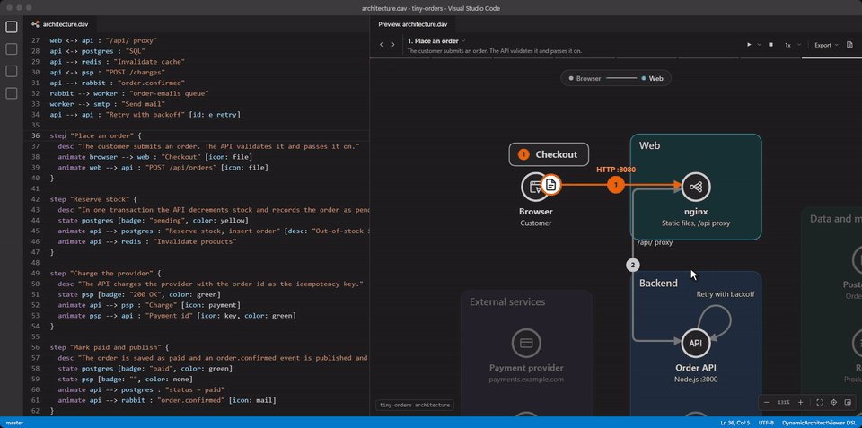

# Documentation

**Using the language**

- [Examples](examples.md): the diagrams in `examples/`, each played as an animated SVG
- [Language specification](specification.md): syntax, attributes, icons, diagnostics and compatibility
- [How diagrams are laid out](layout.md): what to write to get the arrangement you want
- [Writing a large diagram](large-diagrams.md): what the layout does and does not do with 50 nodes or more, and how to write such a diagram
- [What the checker prints](checker.md): every line of `dav check`, each hint and note by its code, the layout lines and the map
- [The `dav` command](../apps/cli/README.md): installing it, every command and option, what each prints, and the exit codes

The preview also has an interactive guide. Open it with the documentation button in the toolbar. To have a coding agent write and explain `.dav` files, install the [AI agent skills](../README.md#ai-agent-skills).

**Working on the code**

- [Architecture](architecture.md): the pipeline, modules, exported HTML and SVG, and tests
- [Design decisions](design-decisions.md): why some features are deliberately absent, and [those of v2](v2/design-decisions.md): why the language changed
- [Readability and layout](v2/readability-and-layout.md): what makes a diagram readable, in the order the layout weighs it, and the [layout algorithm](v2/layout-algorithm.md) that follows from it
- [Contributing](../CONTRIBUTING.md): setup, commands and common changes
- [Releasing](releasing.md): publishing to the Marketplace, Open VSX and npm
