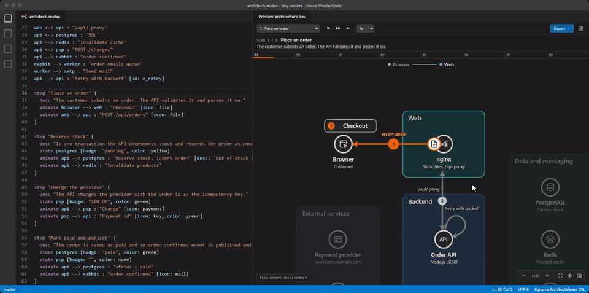

# Documentation

**Using the language**

- [Examples](examples.md): the diagrams in `examples/`, each played as an animated SVG
- [Language specification](specification.md): syntax, attributes, icons, diagnostics and compatibility
- [How diagrams are laid out](layout.md): what to write to get the arrangement you want

The preview also has an interactive guide. Open it with the documentation button in the toolbar. To have a coding agent write and explain `.dav` files, install the [AI agent skills](../README.md#ai-agent-skills).

**Working on the code**

- [Architecture](architecture.md): the pipeline, modules, exported HTML and tests
- [Design decisions](design-decisions.md): why some features are deliberately absent
- [Contributing](../CONTRIBUTING.md): setup, commands and common changes
- [Releasing](releasing.md): publishing to the Marketplace
