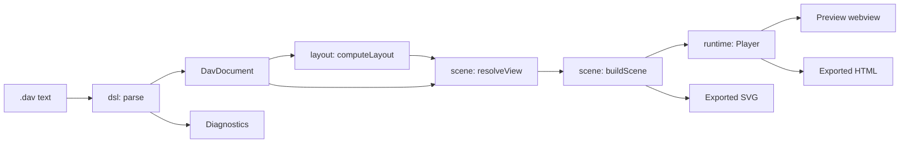

# Architecture

DynamicArchitectViewer is a VS Code extension in `apps/vscode`. It turns a `.dav` file into an animated diagram, in a preview beside the editor, as a standalone HTML file or as an SVG image.

## Principles

1. **The text is the source of truth.** There is no diagram state apart from the `.dav` file.
2. **One renderer.** The preview and exported HTML run the same layout, scene and player code. The SVG export draws the same scene and frames it with the same camera rules.
3. **Exported HTML stands alone.** It makes no network requests and keeps working from `file://`.
4. **Input is untrusted.** Opening a `.dav` or HTML file from someone else must be safe.
5. **Easy to write, including for AI agents.** No coordinates, and errors say what to fix.
6. **Small enough for one person to maintain.** Few dependencies and no framework.

## Pipeline



`resolveView` works out the state of the diagram at a step. `buildScene` turns that into a tree of virtual SVG elements, and `Player` renders the tree and runs the animation. Everything before `Player` is free of the DOM.

**Text without a DOM.** With no DOM, no text can be measured, and it is drawn in whatever font the reader's system has. Every width therefore comes from one estimate, `textWidth(text, size, style)` in `model/text.ts`, for text set normal, bold or monospaced: the room the layout keeps for an edge label, where a label is cut with an ellipsis (`fitText`), how a description wraps (`wrapText`), and the size of a badge or a callout. A printable ASCII character is given the width it has in Segoe UI at its weight, plus 12%: enough for San Francisco, Roboto, Ubuntu and Noto Sans, while in a font wider than those a full line runs a few units into the padding beside it. A CJK character counts as exactly one em, which it is in every font; kana count the same, because they are as wide as kanji in the fonts of macOS, though narrower in those of Windows. `dav-check --detail` reports a cut with the same estimate.

**Callouts are measured where a browser is there.** An estimate must leave room, and room around the text of a callout shows as empty space. So a callout asks for its widths through a measure that can be replaced (`measureCalloutsWith` in `scene/calloutMeasure.ts`). `Player` hands in `browserTextMeasure` (`runtime/measure.ts`), which measures on a canvas in the fonts the page is styled with, and a callout in the preview or in exported HTML is as wide as its text is drawn, in any font. The scene still has no DOM: without a browser, as in the SVG export, in `dav-check` and in the unit tests, the estimate is the measure. The layout and every label outside a callout always go by the estimate, so that the arrangement of a diagram does not depend on the reader's fonts.

## Repository layout

```text
.
├── apps/vscode/             The extension
│   ├── src/                 See the modules below
│   ├── e2e/                 Playwright tests
│   ├── syntaxes/            TextMate grammar
│   └── media/               Icons and screenshot
├── skills/                  Agent skills. See "The agent skills" below
├── .claude-plugin/          Claude Code marketplace that lists the skill
├── examples/                Sample .dav files
└── docs/                    This documentation
```

## Modules

All paths are under `apps/vscode/src`.

| Module | Responsibility | May depend on |
| :--- | :--- | :--- |
| `model/` | Data types and icon metadata. No coordinates or source positions | Nothing |
| `dsl/` | Parser, validation, completions, formatter | `model` |
| `layout/` | `computeLayout(doc)`. See [How diagrams are laid out](layout.md) | `model` |
| `scene/` | Step state, rail geometry, callouts, camera framing, virtual SVG. No DOM | `layout`, `model` |
| `runtime/` | `Player`, shared by the preview and exported HTML | `scene`, `layout`, `model` |
| `exporter/` | Standalone HTML and SVG export, HTML import | `dsl`, `layout`, `model`, `scene`, `runtime` |
| `prompt/` | Prompt template that teaches the language to AI agents | `model` |
| `skill/` | The `dav-check` and `dav-outline` commands bundled with the agent skills | `dsl`, `layout`, `model`, `scene` |
| `protocol/` | Types of the messages between extension and webview | `model` |
| `samples/` | Sample diagrams for the New Diagram command | Nothing |
| `editor/` | The preview webview UI and its documentation | Most of the above |
| `extension/` | The VS Code extension host | `protocol`, `prompt`, `dsl`, `exporter`, `samples`, `model`, `layout` |

[`__tests__/architecture.test.ts`](../apps/vscode/src/__tests__/architecture.test.ts) enforces this table and forbids React. The runtime in particular must not pull in the parser, because it is inlined into every exported file.

## The language

`dsl/grammar/dav.grammar` is a [Lezer](https://lezer.codemirror.net/) grammar, compiled at build time. `dsl/analyze.ts` walks the syntax tree to produce the document, diagnostics and a source map.

```ts
parse(text): { document, diagnostics, sourceMap }
format(text): string                    // Returns the original text on a syntax error
formatDiagnostic(diagnostic, 'ja' | 'en'): string
computeCompletions(text, offset, explicit?, locale?): DslCompletionList | null
findAtOffset(sourceMap, offset): { elementId: string | null; stepIndex: number | null }
```

| Decision | Reason |
| :--- | :--- |
| An LR grammar with error recovery | Accurate positions and useful results while the user is still typing |
| Statements do not depend on line breaks | Moving a `{` to another line is not a syntax error |
| Diagnostics hold a code and arguments, not text | Messages can be produced in each language |
| An invalid attribute is reported and dropped | A typo does not make the whole diagram disappear |
| The source map is separate from the model | Editor details do not leak into exported HTML |

## The player

`runtime/player.ts` draws the scene and plays each step's phases. `runtime/camera.ts` handles zoom and pan.

- `animate` statements play in order, and `parallel: true` joins the preceding phase.
- A callout stays still while its packet moves, and no line joins the two: the callout carries the number of the packet's stop on the rail, in the packet's color. Packets of one phase get a letter each (`5a`, `5b`). A callout takes the free place nearest its own rail, on any side, a little in favor of the middle of the rail where its numbered stop is (`scene/calloutPlace.ts`). It must be nearer its own rail than the rail of any other packet of its phase, unless the two packets share a rail, as a request and its reply do. Only when no free place is found within 600 units does it sit above the middle of its rail regardless. A callout comes no closer than 22 units to its own rail and 12 to any other. It never covers a node's station, badge or labels, the label of an edge, a rail, another callout of its phase, or the strip across the top of a zone, which the zone's name moves along with the camera. Two things it does only where that brings it clearly closer: lie across a zone's side or bottom border (worth 30 units), and use the empty part of a node's cell (worth 12). Callouts of one phase that end up nearly level are set level.
- With `prefers-reduced-motion`, animation stays off. Clicking a node shows the packets of a phase, parked on the rail.
- Drawing uses `createElementNS`, `textContent`, `setAttribute` and CSSOM only: never `innerHTML` or inline `style` attributes.

## Exported HTML

`exportHtml(dsl, options)` in `exporter/export.ts` writes one file:

```html
<!DOCTYPE html>
<html lang="en">
<head>
<meta charset="UTF-8">
<meta http-equiv="Content-Security-Policy" content="default-src 'none'; script-src 'sha256-...'; style-src 'sha256-...'; img-src data:; base-uri 'none'; form-action 'none'">
<title>Diagram title</title>
<style>/* Page and player styles */</style>
</head>
<body>
<script type="application/json" id="dav-data">{ ... }</script>
<script>/* The player, as an IIFE */</script>
</body>
</html>
```

| Field of `dav-data` | Purpose |
| :--- | :--- |
| `format`, `version` | Identify the payload when importing |
| `locale` | Language of the player UI, set from VS Code at export time |
| `dsl` | The original text, for extracting it back |
| `document` | The parsed model, so that the file needs no parser |
| `layout` | The computed layout, so that the arrangement never changes |
| `icons` | Artwork of the icons this diagram uses; the player bundles none |

**Security.** Everything user-written is stored as JSON, with `<`, `>`, `&`, U+2028 and U+2029 escaped so it cannot end the script element. The Content Security Policy allows only the hashes of the inline script and style, with no `'unsafe-inline'`.

**Extracting the DSL.** `importContent(content)` in `exporter/import.ts` reads the `dav-data` JSON without evaluating the page. It checks `format`, `version` and the type of `dsl`, and otherwise returns a reason such as `unrecognized-html`, `unsupported-version` or `corrupt`.

## Exported SVG

`exportSvg(dsl, options)` in `exporter/svg.ts` writes an image for places that show pictures but run no script, such as a README on GitHub or GitLab, where it goes in an ``.

- **Still** (`animate: false`, or a diagram without steps): the overview, framed on the whole diagram.
- **Animated**: every step in a loop at 1x, as "Play all" plays them. The canvas is 960 × 540 below a header with the step's title and description, the step ruler and, when the diagram has zones, the zone strip. When the camera ever shows less than the whole diagram, a minimap sits beside the header rather than over the canvas.
- **Animated, whole diagram** (`camera: 'whole'`): the same playback with the camera kept on everything any step draws. The canvas stays 960 wide and takes the diagram's proportions, at most the preview's fit zoom, between 240 and 1200 high. No minimap is needed.
- **One step** (`step: n`): the step keeps its number in the diagram, as "Step 3 / 8". Animated, it repeats the step's phases as "Play step" does, without the step ruler. Still, it frames the whole diagram under the step's header while showing the scene as the preview does with animation stopped: the step's state, every flow lit in its color, and its rail labels emphasized. A step's state includes what earlier steps set, as in the preview.

Motion uses SMIL only, because `` runs no script. Every animation lasts the length of the whole playback and repeats, so they stay in step without referring to one another:

| What changes | How |
| :--- | :--- |
| The step's scene, a phase's packets, flows, lit stops, emphasized labels and zone outlines | One copy per state, shown with a discrete `display` animation |
| The camera | `viewBox` of the canvas, eased between the poses the preview's camera would head for |
| Zone names on the canvas | Kept inside the visible `viewBox` as the camera moves, as in the preview |
| A packet riding its rail | Positions sampled every 66 ms and at the start, middle and end of each corner of the rail, interpolated in between |

With `camera: 'follow'`, the default, the camera follows the preview's rules from `scene/framing.ts`: each step starts on `stepFrame`, and a phase whose nodes are off screen moves to `calmFrame`. The preview's "follow" toggle and the reader's own panning have no counterpart, and SMIL animations in an `` cannot honor `prefers-reduced-motion` (the whole-diagram or still export moves less). Each element's attributes hold its state at the start of the loop, so a viewer without SMIL shows the first moment of the first step. Colors follow the reader's system light or dark setting, which can differ from the theme of the site showing the image.

**Security.** The scene is serialized by `exporter/xml.ts`, which escapes every text and attribute value and drops characters XML does not allow. The file has no script, no `foreignObject` and no external reference.

## The extension host

`extension/languageFeatures.ts` provides diagnostics, Quick Fixes, completions, formatting and the outline. `extension/extension.ts` registers these commands. While `hasFatalError` (in `dsl/`) holds, meaning the text has errors and nothing to draw, the preview keeps its last diagram and disables its Export button, and the export commands show a warning instead of writing a file:

| Command | Action |
| :--- | :--- |
| `dav.openPreview` | Open the preview beside the editor |
| `dav.exportHtml` | Export a standalone HTML file |
| `dav.exportSvg` | Export an animated SVG (camera following or whole diagram) or a still one |
| `dav.importHtml` | Open the `.dav` text embedded in an exported file |
| `dav.newFromTemplate` | Create a diagram from a sample |
| `dav.copyAiPrompt` | Copy a prompt that teaches the language to an AI agent |
| `dav.installAgentSkill` | Copy the agent skills into a skills directory of Claude Code, Copilot or Codex |

The extension and webview talk through typed messages in `protocol/messages.ts`:

| Message | Direction | Purpose |
| :--- | :--- | :--- |
| `ready` | Webview to extension | The webview has mounted, with the `uri` and `version` of the document it already drew from the page, if any. The extension sends `docChanged` only when they are out of date |
| `docChanged` | Extension to webview | The text changed, so update the diagram |
| `cursorMoved` | Extension to webview | Highlight the element at the cursor, and go to its step |
| `revealRange` | Webview to extension | Double-clicking an element jumps to its declaration |
| `exportHtml` | Webview to extension | Export HTML from the toolbar's Export menu |
| `exportSvg` | Webview to extension | Export an SVG from the same menu, with `animate`, `camera` and `step` (`null` for every step) |

**Layout off the main thread.** Most of `computeLayout` takes a millisecond or two. The exception is the search for where to place the zones of a diagram with links that are too long: about 150 ms for a hundred nodes and over a second for three hundred, and it runs again whenever the structure changes. The webview hands that search to a worker (`editor/zonePlanner.ts`, `editor/zoneSearch.worker.ts`) and keeps showing the diagram it has until the answer arrives; a cursor position that arrives meanwhile waits for it too. Which document the preview is on, which text was last drawable and what is waiting are kept by `editor/documentSession.ts`, which has no DOM; `editor/App.ts` draws what it says. Only the latest text is searched. The worker is inlined into the bundle and started from a blob, which is the only way a webview may start one, so the page's Content Security Policy has `worker-src blob:`. Where no worker can run, the search runs on the page as before. The exporters and `dav-check` call `computeLayout` directly.

**Language.** The UI is Japanese when `vscode.env.language` is Japanese, and English otherwise. The extension writes this into `<html lang>` for the webview, and command titles come from `package.nls*.json`.

## The agent skills

`skills/` holds two skills in the [Agent Skills](https://agentskills.io/specification) format: `dav-diagrams` for writing diagrams and `dav-reading` for explaining them. Only each `SKILL.md` is written by hand. `npm run build:skill` generates the rest:

| Path | Source |
| :--- | :--- |
| `dav-diagrams/scripts/dav-check.mjs` | `src/skill/check.ts`, bundled with the parser so that it needs no install |
| `dav-diagrams/references/` | `docs/specification.md` and `docs/layout.md` |
| `dav-diagrams/assets/examples/` | `examples/` |
| `dav-reading/scripts/dav-outline.mjs` | `src/skill/outline.ts`, bundled the same way |
| `dav-reading/references/` | `docs/specification.md` |

`dav-check` prints the diagnostics of the parser and can format the file. With `--detail` it also prints hints (`src/skill/review.ts`): an edge or packet without a label, a step or packet without a `desc`, a packet that travels where no edge is declared, a diagram without any `code`, and every text that is drawn cut off. Hints are not diagnostics of the language, so the editor does not show them. What is cut off comes from `scene/textCuts.ts`, which asks the same code that draws the text, so the checker cannot disagree with the preview. `--detail` also describes the layout (`src/skill/layoutReport.ts`): the size and proportion of the diagram, the columns and rows its nodes and zones take, and how many connections cross, with notes on a zone stacked in one column, a diagram much taller than wide, and crossings. These lines do not fail the check; they stand in for the look at the preview that an agent cannot take.

`dav-outline` prints what a file says as Markdown or JSON: zones and nodes with their labels, every edge, and for each step its packets in the order they travel, what the step changes and what still shows from earlier steps.

The examples in `examples/` and in `dav-diagrams/SKILL.md` pass `dav-check --detail`, and the excerpts in `dav-reading/SKILL.md` are lines of a real outline; tests keep both true.

The generated files are committed, because the marketplace and the `skills` CLI install directly from the repository. CI fails if they are out of date. The build also copies the skills to `dist/skill/`, because the VSIX contains only `apps/vscode`.

## Tests

| Location | Covers |
| :--- | :--- |
| `src/__tests__/architecture.test.ts` | Dependency direction between modules |
| `src/skill/__tests__/` | Each `SKILL.md` matches the language and its script, and the behavior of `dav-check` and `dav-outline` |
| `src/dsl/__tests__/` | Parsing, every diagnostic, the formatter, and property tests with fast-check |
| `src/layout/__tests__/` | Layout invariants and a crossing budget for each sample |
| `src/scene/__tests__/` | Step state, rails, callouts and rendering |
| `src/samples/__tests__/` | Sample templates match `examples/` |
| `src/model/__tests__/` | The text width estimate, code indentation and other shared helpers |
| `src/exporter/__tests__/` | Exported HTML and its import, the SVG export and its camera plan |
| `src/extension/__tests__/` | Commands, language features and the preview panel, against a mocked `vscode` |
| `src/editor/__tests__/` | Every example in the in-app documentation compiles and plays; what the preview shows as texts, cursor positions and other documents arrive; and the zone search is handed to a worker and taken back correctly |
| `src/prompt/__tests__/` | The AI prompt template, and that it asks for the detail and gives the text sizes of the `dav-diagrams` skill |
| `e2e/` | The preview and exported HTML in a real browser, including that both render the same SVG |
