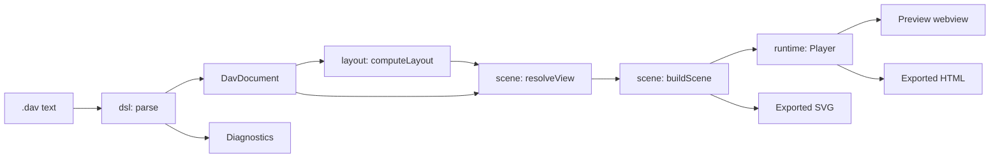

# Architecture

DynamicArchitectViewer is a VS Code extension in `apps/vscode`. It turns a `.dav` file into an animated diagram, in a preview beside the editor or as a standalone HTML file.

## Principles

1. **The text is the source of truth.** There is no diagram state apart from the `.dav` file.
2. **One renderer.** The preview and exported HTML run the same layout, scene and player code. The SVG export draws the same scene and frames it with the same camera rules.
3. **Exported HTML stands alone.** It makes no network requests and keeps working from `file://`.
4. **Input is untrusted.** Opening a `.dav` or HTML file from someone else must be safe.
5. **Easy to write, including for AI agents.** No coordinates, and errors say what to fix.
6. **Small enough for one person to maintain.** Few dependencies and no framework.

## Pipeline



`resolveView` works out the state of the diagram at a step. `buildScene` turns that into a tree of virtual SVG elements, and `Player` renders the tree and runs the animation. Everything before `Player` is free of the DOM.

## Repository layout

```text
.
├── apps/vscode/             The extension
│   ├── src/                 See the modules below
│   ├── e2e/                 Playwright tests
│   ├── syntaxes/            TextMate grammar
│   └── media/               Icons and screenshot
├── skills/dav-diagrams/     Agent skill. See "The agent skill" below
├── .claude-plugin/          Claude Code marketplace that lists the skill
├── examples/                Sample .dav files
└── docs/                    This documentation
```

## Modules

All paths are under `apps/vscode/src`.

| Module | Responsibility | May depend on |
| :--- | :--- | :--- |
| `model/` | Data types and icon metadata. No coordinates or source positions | Nothing |
| `dsl/` | Parser, validation, completions, formatter | `model` |
| `layout/` | `computeLayout(doc)`. See [How diagrams are laid out](layout.md) | `model` |
| `scene/` | Step state, rail geometry, callouts, camera framing, virtual SVG. No DOM | `layout`, `model` |
| `runtime/` | `Player`, shared by the preview and exported HTML | `scene`, `layout`, `model` |
| `exporter/` | Standalone HTML and SVG export, HTML import | `dsl`, `layout`, `model`, `scene`, `runtime` |
| `prompt/` | Prompt template that teaches the language to AI agents | `model` |
| `skill/` | The `dav-check` command bundled with the agent skill | `dsl`, `model` |
| `protocol/` | Types of the messages between extension and webview | Nothing |
| `samples/` | Sample diagrams for the New Diagram command | Nothing |
| `editor/` | The preview webview UI and its documentation | Most of the above |
| `extension/` | The VS Code extension host | `protocol`, `prompt`, `dsl`, `exporter`, `samples`, `model`, `layout` |

[`__tests__/architecture.test.ts`](../apps/vscode/src/__tests__/architecture.test.ts) enforces this table and forbids React. The runtime in particular must not pull in the parser, because it is inlined into every exported file.

## The language

`dsl/grammar/dav.grammar` is a [Lezer](https://lezer.codemirror.net/) grammar, compiled at build time. `dsl/analyze.ts` walks the syntax tree to produce the document, diagnostics and a source map.

```ts
parse(text): { document, diagnostics, sourceMap }
format(text): string                    // Returns the original text on a syntax error
formatDiagnostic(diagnostic, 'ja' | 'en'): string
computeCompletions(text, offset, includeSnippets?): DslCompletionList | null
findAtOffset(sourceMap, offset): { elementId: string | null; stepIndex: number | null }
```

| Decision | Reason |
| :--- | :--- |
| An LR grammar with error recovery | Accurate positions and useful results while the user is still typing |
| Statements do not depend on line breaks | Moving a `{` to another line is not a syntax error |
| Diagnostics hold a code and arguments, not text | Messages can be produced in each language |
| An invalid attribute is reported and dropped | A typo does not make the whole diagram disappear |
| The source map is separate from the model | Editor details do not leak into exported HTML |

## The player

`runtime/player.ts` draws the scene and plays each step's phases. `runtime/camera.ts` handles zoom and pan.

- `animate` statements play in order, and `parallel: true` joins the preceding phase.
- Callouts stay still while their pointer follows the packet. Callouts of one phase that would overlap are moved sideways by the smallest distance that clears them (`scene/callout.ts`).
- With `prefers-reduced-motion`, animation stays off. Clicking a node shows the packets of a phase, parked on the rail.
- Drawing uses `createElementNS`, `textContent`, `setAttribute` and CSSOM only: never `innerHTML` or inline `style` attributes.

## Exported HTML

`exportHtml(dsl, options)` in `exporter/export.ts` writes one file:

```html
<!DOCTYPE html>
<html lang="en">
<head>
<meta charset="UTF-8">
<meta http-equiv="Content-Security-Policy" content="default-src 'none'; script-src 'sha256-...'; style-src 'sha256-...'; img-src data:; base-uri 'none'; form-action 'none'">
<title>Diagram title</title>
<style>/* Page and player styles */</style>
</head>
<body>
<script type="application/json" id="dav-data">{ ... }</script>
<script>/* The player, as an IIFE */</script>
</body>
</html>
```

| Field of `dav-data` | Purpose |
| :--- | :--- |
| `format`, `version` | Identify the payload when importing |
| `locale` | Language of the player UI, set from VS Code at export time |
| `dsl` | The original text, for extracting it back |
| `document` | The parsed model, so that the file needs no parser |
| `layout` | The computed layout, so that the arrangement never changes |
| `icons` | Artwork of the icons this diagram uses; the player bundles none |

**Security.** Everything user-written is stored as JSON, with `<`, `>`, `&`, U+2028 and U+2029 escaped so it cannot end the script element. The Content Security Policy allows only the hashes of the inline script and style, with no `'unsafe-inline'`.

**Extracting the DSL.** `importContent(content)` in `exporter/import.ts` reads the `dav-data` JSON without evaluating the page. It checks `format`, `version` and the type of `dsl`, and otherwise returns a reason such as `unrecognized-html`, `unsupported-version` or `corrupt`.

## Exported SVG

`exportSvg(dsl, options)` in `exporter/svg.ts` writes an image for places that show pictures but run no script, such as a README on GitHub or GitLab, where it goes in an ``.

- **Still** (`animate: false`, or a diagram without steps): the overview, framed on the whole diagram.
- **Animated**: every step in a loop at 1x, as "Play all" plays them. The canvas is 960 × 540 below a header with the step's title and description, the step ruler and, when the diagram has zones, the zone strip. When the camera ever shows less than the whole diagram, a minimap sits beside the header rather than over the canvas.

Motion uses SMIL only, because `` runs no script. Every animation lasts the length of the whole playback and repeats, so they stay in step without referring to one another:

| What changes | How |
| :--- | :--- |
| The step's scene, a phase's packets, flows, lit stops, emphasized labels and zone outlines | One copy per state, shown with a discrete `display` animation |
| The camera | `viewBox` of the canvas, eased between the poses the preview's camera would head for |
| Zone names on the canvas | Kept inside the visible `viewBox` as the camera moves, as in the preview |
| A packet riding its rail, and the leader of its callout | Positions sampled every 66 ms, interpolated in between |

The camera follows the preview's rules from `scene/framing.ts`: each step starts on `stepFrame`, and a phase whose nodes are off screen moves to `calmFrame`. The preview's "follow" toggle and the reader's own panning have no counterpart, and SMIL animations in an `` cannot honor `prefers-reduced-motion` (use the still SVG export when motion is unwanted). Each element's attributes hold its state at the start of the loop, so a viewer without SMIL shows the first moment of the first step. Colors follow the reader's system light or dark setting, which can differ from the theme of the site showing the image.

**Security.** The scene is serialized by `exporter/xml.ts`, which escapes every text and attribute value and drops characters XML does not allow. The file has no script, no `foreignObject` and no external reference.

## The extension host

`extension/languageFeatures.ts` provides diagnostics, Quick Fixes, completions, formatting and the outline. `extension/extension.ts` registers these commands:

| Command | Action |
| :--- | :--- |
| `dav.openPreview` | Open the preview beside the editor |
| `dav.exportHtml` | Export a standalone HTML file |
| `dav.exportSvg` | Export an animated or still SVG image |
| `dav.importHtml` | Open the `.dav` text embedded in an exported file |
| `dav.newFromTemplate` | Create a diagram from a sample |
| `dav.copyAiPrompt` | Copy a prompt that teaches the language to an AI agent |
| `dav.installAgentSkill` | Copy the agent skill into a skills directory of Claude Code, Copilot or Codex |

The extension and webview talk through typed messages in `protocol/messages.ts`:

| Message | Direction | Purpose |
| :--- | :--- | :--- |
| `docChanged` | Extension to webview | The text changed, so update the diagram |
| `cursorMoved` | Extension to webview | Highlight the element at the cursor, and go to its step |
| `revealRange` | Webview to extension | Double-clicking an element jumps to its declaration |
| `exportHtml` | Webview to extension | Export from the toolbar |

**Language.** The UI is Japanese when `vscode.env.language` is Japanese, and English otherwise. The extension writes this into `<html lang>` for the webview, and command titles come from `package.nls*.json`.

## The agent skill

`skills/dav-diagrams/` follows the [Agent Skills](https://agentskills.io/specification) format. Only `SKILL.md` is written by hand. `npm run build:skill` generates the rest:

| Path | Source |
| :--- | :--- |
| `scripts/dav-check.mjs` | `src/skill/check.ts`, bundled with the parser so that it needs no install |
| `references/` | `docs/specification.md` and `docs/layout.md` |
| `assets/examples/` | `examples/` |

The generated files are committed, because the marketplace and the `skills` CLI install directly from the repository. CI fails if they are out of date. The build also copies the skill to `dist/skill/`, because the VSIX contains only `apps/vscode`.

## Tests

| Location | Covers |
| :--- | :--- |
| `src/__tests__/architecture.test.ts` | Dependency direction between modules |
| `src/skill/__tests__/` | `SKILL.md` matches the language, and the behavior of the checker |
| `src/dsl/__tests__/` | Parsing, every diagnostic, the formatter, and property tests with fast-check |
| `src/layout/__tests__/` | Layout invariants and a crossing budget for each sample |
| `src/scene/__tests__/` | Step state, rails, callouts and rendering |
| `src/samples/__tests__/` | Sample templates match `examples/` |
| `e2e/` | The preview and exported HTML in a real browser, including that both render the same SVG |
