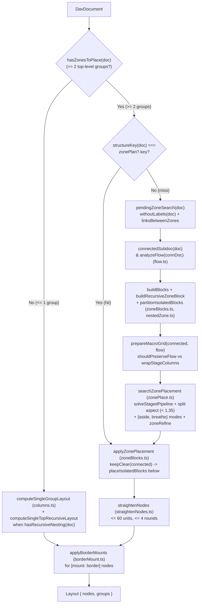

# Layout algorithm specification (`dav 2`)

This document specifies how `apps/vscode/src/layout/` computes node and group rectangles from a parsed `DavDocument` (`computeLayout(doc)`), together with how `apps/vscode/src/editor/zonePlanner.ts` and `apps/vscode/src/editor/zoneSearch.worker.ts` schedule background zone placement. For the readability principles that motivate these rules, see [Readability and layout principles](readability-and-layout.md).

Per [`architecture.test.ts`](../../apps/vscode/src/__tests__/architecture.test.ts), `layout/` imports only from `layout/` and `model/` (forbidding `react`, `react-dom`, `@lezer/`, DOM APIs, and `scene/`). Orthogonal rail routing (`scene/route.ts`) and callout placement (`scene/calloutPlace.ts`) execute downstream in `scene/`.

## Module architecture overview

`apps/vscode/src/layout/` comprises **15** TypeScript modules, paired with **2** editor scheduling modules:

| Module | Responsibility |
| :--- | :--- |
| `layout/metrics.ts` | Fixed geometry constants (`NODE_SIZE`, `STATION_CENTER`, `STATION_SIZE`, `WINDOW_SIZE`, `GROUP_PADDING`, `GROUP_HEADER`, `ORIGIN`, `EMPTY_GROUP_CONTENT`, `SELF_LOOP_ROOM`), group header wrapping/minimum width (`groupHeaderHeight`, `zoneMinWidth`, `zoneNeededWidth`), and rectangle primitives (`stationRect`, `selfLoopRoom`, `rectRecord`, `rectOverlaps`, `rectContains`, `enclosingRect`). |
| `layout/ranks.ts` | `computeRanks(ids, edges)` — iterative DFS cycle breaking (`BackEdge { from, to, loop, root }`) and Kahn longest-path DAG ranks (`RankResult`). |
| `layout/links.ts` | Straight-line station/group-endpoint segment primitives (`linksOf`, `segmentsOf`, `shareStation`, `properlyCross`, `crossingsOf`, `countCrossings`, `primaryCrossingsOf`). |
| `layout/flow.ts` | Chronological step-order flow analysis (`analyzeFlow`, `analyzeScopeFlow`): `TransitionRole` (`'primary'` / `'return'` / `'static'`), `egressReturnPairs` / `isStaticRankExcluded` (Rules S1–S3), `flowPairKey`, canonical `isLateAuxAlert`, `canReach`, `primaryCorridors`, wrap-aware `countCorridorIntrusions`, and macro `zoneStage` / `auxiliaryZones`. |
| `layout/columns.ts` | Rank-based column/cluster layout for diagrams with `<= 1` top-level group (`computeSingleGroupLayout`) and single-zone interiors (`computeColumnLayout`, `refineOrder`, `buildColumnPlan`, `placeAuto`, `computeGroupRects`). |
| `layout/nestedZone.ts` | Bottom-up recursive container layout (`hasRecursiveNesting`, `buildRecursiveZoneBlock`, `computeSingleTopRecursiveLayout`): scoped stage placement (`NESTED_SPACING`), same-step parallel fan-out column merging, `detectIsomorphicSiblings` (same-stage symmetry), `alignStackedSiblingColumns` (shared outer width and child-column grids), wide-2-stage vertical stacking, and corner-pocket auxiliary placement. |
| `layout/borderMount.ts` | Post-layout boundary mounting (`applyBorderMounts`) for `[mount: border]` nodes: automatic external-facing border side selection, parent border inward shrink, in-band `animate`-priority coordinate alignment, header clearance, and multi-mount separation. |
| `layout/zoneBlocks.ts` | Zone block construction (`buildSingleZoneBlock`, `buildBlocks`, `TOP_SPACING`, `NESTED_SPACING`), `intraZoneFlow`, `structureKey`, `connectedSubdoc`, `withoutLabels`, `partitionIsolatedBlocks`, `placeIsolatedBlocks`, `stageColumns`, `shouldPreserveFlow`, row-wrap input preprocessor (`splitTallStaticColumns`, `wrapStageColumns`, `prepareMacroGrid`), `initialPositions`, `placeAuxiliaryBand`, `placeAuxiliaryBlocks`, `keepClear`, `applyNodeOrder`, `applyZonePlacement`, `toLayout`. |
| `layout/zoneScore.ts` | Single unified objective module: wrap-aware `FlowContext` (`buildFlowContext`), `BlockLink` (`buildLinks`), `linkCost`, `movedCost`, `evaluateMove`, `wallDetourCount`, `blockedPrimaryPorts`, `rightwardShare`, `estimateRoutingDefects`, `diagramCrossingPenalty`, `countBackwardPrimary`, `evaluateArrangementScore` (`'full' \| 'staged' \| 'intrusion' \| 'flip'`), and typed-array `createFastCrossingEvaluator` / `evaluateAnchoredObjective`. |
| `layout/zoneFinish.ts` | Geometric zone finishing: `alignEdges`, `tighten`, `compact`, `restoreStageBreathingRoom`, `straighten` (with coupled 2-block / 3-block shifts and `corridorReturnBiasY`), and `eliminateShortJogs`. |
| `layout/zoneRefine.ts` | Intra-zone and bounded coordinate refinement: `RefineBudget`, `deriveRefineBudget`, `optimizeZoneSlackRanks`, `refineZoneNodeOrder`, unified `optimizeZoneFlips` (exact bitmask + `'score-greedy'` with optional `symmetryGroups`), and `polishZoneCoordinates`. |
| `layout/zonePlace.ts` | Single deterministic stage+band macro solver (`searchZonePlacement`): canonical `arrange`, continuous `buildSplitStageColumns`, `solveStagedPipeline`, band guards, `clearCorridorIntrusions`, `{ aside, breathe }` mode grid, and final candidate scoring. |
| `layout/zoned.ts` | Internal barrel bridging `zoneBlocks.ts` and `zonePlace.ts:searchZonePlacement` to `index.ts`. |
| `layout/straightenNodes.ts` | Post-placement single-node straightening inside parent frames (`REACH = 60`, `ROUNDS = 4`) while guarding inter-zone `'primary'` links (`dx > 0` preserved). |
| `layout/index.ts` | Public facade (`computeLayout`, `zonesPlacedFreely`, `backEdgesOf`, `pendingZoneSearch`, `adoptZonePlan`, `searchZones`, unified `scopeBackEdges`) and geometry/type re-exports. |
| `editor/zonePlanner.ts` | Single-worker async `ZonePlanner` queue (`SETTLE_FROM_LINKS = 50`, `SETTLE_MS = 200`, `whenPlanned`, `cancel`, `dispose`, `#underWay` coalescing, CSP/error main-thread fallback). |
| `editor/zoneSearch.worker.ts` | Web Worker entrypoint receiving `ZoneSearchRequest` (`ZoneSearch`) and posting `{ key, placement: searchZones(doc) }`. |

---

## 1. Core invariants and determinism contract

1. **Pure function of the document (`layout = f(doc)`):**
   `computeLayout(doc)` holds zero editing-history state across edits. Although `layout/index.ts` caches the latest `ZonePlacement` under `zonePlan = { key: structureKey(doc), placement }`, `structureKey(doc)` captures every structural input that zone search reads—including `nodes`, `groups`, `selfLoops`, `flowStructureSnapshot(doc)` (connection-bearing step indices and `activeStepCount >= 4`), and `flowStructureSnapshot(connSubdoc)` when `connDoc !== doc`—so cold `computeLayout(docB)` and warm `docA -> docB` produce identical coordinates (`0.000` units difference).
2. **Strict determinism (zero PRNG, zero seeds):**
   Zone search (`zonePlace.ts`) and column placement (`columns.ts`) are 100% deterministic with no random number generation, hash-based perturbations, or wall-clock / OS dependence. Remaining structural ties use canonical keys: `stageColumns` sorts within columns by `compareBlockId`, `splitTallStaticColumns` sorts by `(-interDegree, -nodes.size, compareBlockId)`, `arrange` sorts connected blocks by the 6-tuple `(isAux, firstAnimStep ?? firstAnyStep ?? 0, zoneStage, -nodes.size, -interPriDeg, id)`, and `placeIsolatedBlocks` sorts by `compareBlockId`.
3. **Sync and single-worker equivalence:**
   Running `ZonePlanner` (`editor/zonePlanner.ts`) on its single background Web Worker (`editor/zoneSearch.worker.ts`) calls `searchZones(doc)` on the label-stripped `ZoneSearch.doc`, returning the exact same `ZonePlacement` as synchronous `zonePlacementOf(doc)` inside `computeLayout(doc)`.
4. **`zonesPlacedFreely(doc) === hasZonesToPlace(doc)`:**
   Free-zone placement activates strictly when `topLevelGroups(doc.groups).length >= MIN_ZONES` (`MIN_ZONES = 2`). Diagrams with `>= 2` top-level groups always pass through the unified `zonePlace.ts` macro solver and `applyZonePlacement` without any fallback to `columns.ts`; diagrams with `<= 1` top-level group always pass through `computeSingleGroupLayout(doc)`.
5. **Isolated-element immunity (`0.0`-px drift across BOTH modes):**
   Adding, removing, renaming, or editing internals of isolated `deg === 0` blocks causes `0.0` units of drift on connected nodes and frames in **both** `>= 2` and `<= 1` top-level group modes (with the single structural boundary where removing 1 of 2 top-level groups drops `topLevelGroups` below `2`, switching modes, or transitioning an empty/single-singleton fast path in `<= 1` mode):
   - **`>= 2` top-level groups (`zoneBlocks.ts`, `zonePlace.ts`):** Connected solving (`arrange`, `initialPositions`, `shouldPreserveFlow`) runs strictly over `connectedSubdoc(doc)`, `buildBlocks` supplies `connFlow` to connected zones and `docFlow` to isolated zones, and `applyZonePlacement` runs `keepClear` strictly on `connected` before `placeIsolatedBlocks(isolated, placed)` packs isolated blocks below `maxY + ROW_GAP` (`ROW_GAP = 44`) with per-block `extraTop = b.groups.size === 0 ? b.loopRoom : 0` and per-row `rowBottom` tracking.
   - **`<= 1` top-level group (`columns.ts:computeSingleGroupLayout`):** Partitions blocks into `mainComp` (containing `topGroupId` when connected or when no `multiComps` exist, else the earliest-declared `>= 2`-node component), secondary `multiComps` (`>= 2`-node components stacked below `maxY + ISOLATED_ROW_GAP`, `ISOLATED_ROW_GAP = 44`), any isolated `deg === 0` `topGroupId` (`isolatedGroupId`) stacked below `multiComps` at `maxY + ISOLATED_ROW_GAP`, and `singletonIds` (`deg === 0` singletons placed below via `placeIsolatedBlocks` with `Math.round`), ensuring isolated node or isolated group additions never perturb `mainComp` or `multiComps`.
6. **Non-structural edit and label behavior (`structureKey`, `withoutLabels`):**
   `pendingZoneSearch(doc)` computes `structureKey(doc)` before stripping `step.statics` labels via `withoutLabels(doc)`:
   - **Ignored by `structureKey`:** Pure annotation steps containing no inter-node `animate` or `static` statements (`desc`, `focus`, `state`), step/animation `description`s, node/group/edge display labels (`label`, `sub`, `badge`), and later-step repeat animations inside an already-active step on an unordered pair already classified in an earlier step (provided they do not upgrade a `'static'`-only pair to animated, convert an empty step before a later active step into an active step, or push `activeStepCount` from `3` to `4`).
   - **Invalidates `structureKey`:** Changes to node or group IDs, order, `parentId`, or node `mount`, distinct connection pairs (including group-endpoint `static` links), their first-seen insertion order, roles (`'primary'`, `'return'`, `'static'`), arrow directionality (`forward` vs `bidirectional`), `forwardEdges` order, self-loops, `activeStepCount >= 4`, or `pairFirstStep`.
   - **Label width effects:** `NODE_SIZE` (`176 × 118`) is fixed, so node labels (`label`, `sub`, `badge`) and `animate` labels never widen a node; group labels set a minimum group width (`zoneMinWidth`) so headers fit within two wrapped lines without truncation. `step.statics` labels between adjacent internal columns (`|rf - rt| === 1` in `columns.ts`) widen column gaps locally during `applyZonePlacement`, after which `keepClear` pushes overlapping connected zones right without re-running zone search.

---

## 2. End-to-end pipeline

In VS Code (`editor/zonePlanner.ts`), when `pendingZoneSearch(doc)` returns a `ZoneSearch`, `ZonePlanner` dispatches `searchZones` to a single background Web Worker (`editor/zoneSearch.worker.ts`):
- When `pendingZoneSearch(doc)` returns `undefined` (`<= 1` top-level group or `structureKey` cache hit), `whenPlanned` invokes `ready()` synchronously.
- In-flight (`#running`) or debouncing (`#settling`) jobs with the same `search.key` are coalesced via `#underWay(search.key)`; newer structural edits drop `#next` and clear `#running.ready`.
- Non-urgent searches (`!urgent`) with `search.links >= SETTLE_FROM_LINKS` (`50`) wait `SETTLE_MS = 200` ms before enqueueing on the worker; urgent searches start immediately.
- If worker creation throws or `onerror` fires (for example under a restrictive CSP), `#giveUpOnWorkers()` terminates the worker, sets `#worker = null` permanently, and executes `adoptZonePlan(job.search.key, searchZones(job.search.doc))` synchronously on the main thread.

---

## 3. Stage 1 — Chronological flow, macro zones, and unified `backEdgesOf` (`flow.ts`, `index.ts`)

`analyzeFlow(doc)` walks `doc.steps` in order, counting `activeStepCount` strictly over **connection-bearing steps** (steps with at least one valid inter-node `static` or `animate` connection in `connByPair`). Pure `desc` / `focus` / `state` / self-loop-only steps are skipped so they never shift `pairFirstStep` or `activeStepCount`.

### 3.1 Connection roles (`TransitionRole`)
- **Earliest active step (`pairFirstStep`):** Records the earliest `activeStepIdx` (`0 .. activeStepCount - 1`) at which each unordered inter-node pair (`flowPairKey(u, v)`) appears.
- **Order-independent forward `static` bridge activation:** Within each active step, unidirectional (`s.direction === 'forward'`) `step.statics` are collected first, then propagated across `effectiveEntered` (`activateStaticEdge`) so multi-hop forward chains (`a ..> b`, `b ..> c`) activate reachability regardless of statement order inside the step. Bidirectional `static` statements (`<.>`, `<->`) do not propagate reachability bridges; mutual intra-step forward static cycles break in statement order.
- **Role classification per `animate` transition:**
  - Once an unordered pair `key = flowPairKey(from, to)` is classified in `byPair`, later-step `animate` statements on that same pair are skipped (`if (byPair.has(key)) continue`) so they never mutate `primaryEdges`, `nodeAdj`, `zoneAdj`, or `returnReached`.
  - **Bidirectional `<->` orientation:** Uses written `from -> to` by default, but flips to `src = to, dst = from` when `to` already reaches `from` in `effectiveNodeAdj` (or `zv` reaches `zu` in `effectiveZoneAdj`) without reverse reachability. If both directions already close a node cycle or an entered-zone cycle, it is classified `'return'`.
  - **Unidirectional `-->` / `..>` `'return'` check:** Classified `'return'` when:
    1. `canReach(effectiveNodeAdj, to, from)` (closes a node cycle),
    2. `zu !== zv && enteredZones.has(zv) && canReach(effectiveZoneAdj, zv, zu)` (returns into an already-entered upstream zone), or
    3. `returnReached.has(from) && enteredSeq.has(to)` (`returnCont`: continues an intra-zone return chain into a previously visited node).
  - **`'primary'`:** First-visit forward progression; deduplicated via `seenPrimaryEdges` into `primaryEdges` and added to `nodeAdj` / `zoneAdj`.
  - **`'static'` and rank separation (Rules S1–S3):** Pairs appearing only in `static` statements (which may use node or group IDs as endpoints). When `hasAnimate` is true, `isStaticRankExcluded` prevents secondary `static` edges from distorting primary column ranks:
    - **Rule S1:** Excludes a `static` edge between two nodes that already belong to the primary backbone (`primaryNodes`) unless it stays inside a single leaf group with no primary path connecting them.
    - **Rule S2 (`egressReturnPairs`):** Detects static return chains (such as `app ..> nat_gw ..> igw`) leaving a downstream primary node through static-only intermediaries back to an upstream primary node, excluding them from forward ranking and stage votes so Public/NAT subnets stay upstream rather than inverting past Data tiers.
    - **Rule S3:** Pure `static` sinks with no return back to an earlier primary node remain downstream of their feeding primary node; otherwise a `static` pair enters `forwardEdges` only if it closes neither a node cycle (`nodeAdj`) nor a zone cycle (`zoneAdj`). When `hasAnimate` is false, all `static` edges enter `forwardEdges` for DFS cycle breaking.

### 3.2 Late-step decay, `isLateAuxAlert`, `auxiliaryZones`, and `analyzeScopeFlow`
Directional stage votes always weight earliest step appearance via `stepScore(fs) = 1 / (1 + 0.05 * fs)`, while auxiliary/animate degree accumulation decays after active step `2` on multi-step diagrams (`multiStep = activeStepCount >= 4`):
- `stepDecay(fs) = multiStep ? 1 / (1 + 0.12 * max(0, fs - 2)) : 1`
- `stepScore(fs) = 1 / (1 + 0.05 * fs)`

Canonical `isLateAuxAlert(conn, flow, owners)` (`flow.ts`) returns `true` when a `'primary'` link leaves an auxiliary zone (`za`) into a non-auxiliary zone (`zb`) with `firstStep >= 2` and `zoneStage(za) >= zoneStage(zb)`, demoting late auxiliary alert callbacks to `'return'` inside `zoneScore.ts:buildLinks` and `zonePlace.ts:solveStagedPipeline`.

When `hasAnimate` is true, a group `id` is added to `auxiliaryZones` if:
- `priInter === 0 && distinctNbrs >= 2` (zero inter-zone `'primary'` connections, connected to `>= 2` other blocks), **or**
- `staticHeavy && distinctNbrs >= 3`, where `isSharedBag = zoneNodeCount >= 2 && intraTotal === 0` uses `staticHeavy = (stat > anim)`, while single-node zones and zones with internal connections count decayed internal `'primary'` links (`intraPri`) and require `staticHeavy = (stat > (anim + intraPri) * 2)` so multi-tier workload AZs with heavy static replication/endpoint edges are not misclassified as auxiliary.
- **All-auxiliary collapse guard:** If `auxiliaryZones` would leave zero inter-zone `'primary'` edges (`primaryInter.size === 0`) or fewer than `2` connected non-auxiliary blocks (`nonAuxConnected < 2`), `auxiliaryZones.clear()` runs so inter-zone `static` stages are preserved.

`analyzeScopeFlow(groupBlockIds, blockIds, owners, fullFlow)` applies the same macro stage and auxiliary classification recursively to the direct children of any composite container in `nestedZone.ts`.

### 3.3 Acyclic `zoneStage`, `primaryCorridors`, and unified `backEdgesOf`
1. **Directed votes & `primaryComponentAdj`:** Inter-zone `'primary'` edges vote `3 * stepScore(fs)`; unidirectional `'static'` edges vote `0.1 * stepScore(fs)`. If two non-auxiliary blocks with `primaryDegree > 0` are already connected in `primaryComponentAdj` and share no direct `'primary'` edge, `'static'`-only links between them are ignored when building the stage DAG.
2. **Stage DAG & terminal rules:** Equal-vote direction ties (`fwd === rev`) break via `chronZoneAdj` chronological reachability (else `compareId`), and `pairMargin` pairs sort by `(nonAux ? 1000 : 0) + priBonus + voteDiff` with ties broken lexicographically by `compareId` (`compareId(x.a, y.a) || compareId(x.b, y.b)`), inserting edges that do not form cycles. Non-auxiliary blocks get longest-path `zoneStage = 0, 1, ...`; auxiliary zones receive the `Math.round`-rounded `stepDecay`-weighted mean stage of their non-auxiliary neighbors; non-auxiliary blocks attached solely to auxiliary zones stage at `max(auxStage + 1)` (incoming primary), `max(0, min(auxStage - 1))` (outgoing primary), or `Math.round` mean stage; unoriented 1-neighbor primary blocks (`indeg === 0 && outdeg === 0`) stage at `zoneStage(onlyNbr) + 1` when `zoneStage(onlyNbr) > 0 || compareId(onlyNbr, id) < 0` (lexicographic block ID order).
3. **Primary corridors (`primaryCorridors`, `countCorridorIntrusions`):** Built strictly over non-auxiliary inter-zone `'primary'` pairs `(a, b)`, collecting intermediate zones on forward primary paths in either orientation (`a ->* zc ->* b` or `b ->* zc ->* a`) into `allowed`. When `rowOfBlock` is provided for a wrapped grid, cross-row corridors and blocks on different rows are skipped. Otherwise, a zone `c ∉ {a, b} ∪ allowed` counts as an intrusion when its horizontal center `rc.x + rc.width / 2` lies strictly between `a`'s center X and `b`'s center X (`cx > minX && cx < maxX`) and its vertical bounding box overlaps `[min(ra.y, rb.y), max(ra.y + ra.height, rb.y + rb.height)]`.
4. **Unified cycle back-edges (`index.ts: backEdgesOf` via `scopeBackEdges`):** Collects `rawForwardDirs` (`direction === 'forward'`, `from !== to`) and calls a single `scopeBackEdges` helper:
   - When `!hasZonesToPlace(doc)` (`<= 1` top-level group): runs once over all `doc.nodes` using `analyzeFlow(doc, connections)`.
   - When `hasZonesToPlace(doc)` (`>= 2` top-level groups): runs per top-level group using `intraZoneFlow(idSet, zConns, zDocFlow, owners)` (selecting `connFlow` for connected zones and `fullFlow` for isolated zones) plus `ZonePlacement.ranks` slack overrides.

---

## 4. Stage 2 — Internal column layout (`ranks.ts`, `columns.ts`) and block partitioning (`zoneBlocks.ts`)

### 4.1 Node and group column layout (`ranks.ts`, `columns.ts`)
- **Node & self-loop geometry (`metrics.ts`):** Every node is `176 × 118` (`NODE_SIZE`), with station center `50` units below top (`STATION_CENTER`). Nodes with self-loops reserve `SELF_LOOP_ROOM = 30` above every row of a `computeColumnLayout` call (`tallestLoop = max(0, ...selfLoopRoom(doc).values())`).
- **Ranks & columns (`ranks.ts`, `columns.ts`):** Iterative DFS breaks cycles in node/edge order; Kahn longest-path ranks compute `rank[v] = max(rank[u] + 1)`. Non-overlapping rank spans sit side-by-side (`COLUMN_GAP = 36`, widened to `36..148` by `congestionGap` plus `0/16/32` frame boundaries and `staticLabelGapAfter` for `|rf - rt| === 1` `step.statics` labels); overlapping spans stack with `CLUSTER_GAP = 28` (node row gap `ROW_GAP = 14`, widened to `14..34` under long-span / hub congestion).
- **Order refinement (`refineOrder`):** Up to `MAX_SWEEPS = 16` alternating left/right barycenter passes (`SWEEP_PATIENCE = 4`, skipped when `> MAX_REFINED_EDGES = 500`), accepted only when `countCrossings` drops or stays equal with shorter vertical rail span.
- **`computeSingleGroupLayout(doc)` (`<= 1` top-level group):** Partitions blocks into `mainComp`, `multiComps`, `isolatedGroupId` (when `topGroupId` is `deg === 0` alongside `multiComps`), and `singletonIds`. Runs the fast path (`straightenNodes(doc, computeColumnLayout(doc))`) only when `isolatedGroupId === undefined && multiComps.length === 0 && (singletonIds.length === 0 || (mainComp === undefined && singletonIds.length <= 1))`; otherwise lays out `mainComp`, stacks `multiComps` and any `isolatedGroupId` below `maxY + ISOLATED_ROW_GAP` (`44`) aligned to `minX`, and places `singletonIds` below via `placeIsolatedBlocks` with `Math.round`.
- **Per-zone blocks (`buildSingleZoneBlock`, `intraZoneFlow`):** Each top-level group is laid out standalone via `intraZoneFlow`, which computes external stage pull (`extBias`: `primary = 3`, `static = 1`, `return = 0.2`) and reverses intra-zone bidirectional `static` edges when `extBias(from) > extBias(to)`. A non-empty zone block sets `flippable = (loopRoom === 0 && nested.length === 0)`, computes per-level reflection metadata (`computeFlipMetadata` -> `groupsFlipped`, `reflectConst`), and records `loopRoom` plus `nodeLoopRoom`.

### 4.2 Isolated block partitioning (`partitionIsolatedBlocks`, `placeIsolatedBlocks`)
- Top-level blocks with zero inter-block connections in `flow.connections` are partitioned into `isolated`.
- `placeIsolatedBlocks` sorts `isolated` lexicographically by `id` (`compareBlockId`) and places them in rows starting at `(minX, maxY + ROW_GAP)` (`ROW_GAP = 44`), wrapping at `max(1800, maxX - minX)` with `HORIZONTAL_CLEARANCE = 60`. Each ungrouped isolated node reserves its own per-block headroom `extraTop = b.groups.size === 0 ? b.loopRoom : 0`, tracked via per-row `rowBottom`.
- `applyZonePlacement` runs `keepClear` strictly on `connected` blocks first, then appends `placeIsolatedBlocks(isolated, placed)` before `toLayout` shifts `(minX, minY)` to `ORIGIN` (`40, 40`).

### 4.3 Bottom-up recursive container layout (`nestedZone.ts`)
Both multi-top-level diagrams (`buildBlocks` passing `buildRecursiveZoneBlock`) and single-top-level deeply nested diagrams (`hasRecursiveNesting(doc)` -> `computeSingleTopRecursiveLayout`) lay out nested group hierarchies bottom-up rather than forcing global shared columns across independent subtrees:
- **Leaf groups & single-child wrappers:** Leaf groups lay out via `buildSingleZoneBlock` with `zoneMinWidth` / `groupHeaderHeight` (2-line header wrapping). Single-child wrappers (`directGroups.length === 1 && directNodes.length === 0`) wrap their child directly.
- **Composite containers (`placeContainerChildren`):** Runs `analyzeScopeFlow` over direct children using `NESTED_SPACING` (`stageGap: 48`, `rowGap: 24`, `horizontalClearance: 36`, `verticalClearance: 22`, `auxGap: 32`):
  1. **Same-step parallel fan-out column merging:** Adjacent single-block trailing stages fed in the same step by a shared upstream distributor with `static` links between them (e.g. Multi-AZ containers linked by replication) merge into one vertical stage column.
  2. **Isomorphic sibling symmetry (`detectIsomorphicSiblings`):** Computes structural signatures including `scopeFlow.zoneStage`, `auxiliaryZones` membership, child counts, and per-child degree profiles so parallel same-stage siblings (never upstream/downstream pipeline stages) synchronize flips in `optimizeZoneFlips` and equalize minor width differences (`<= 80` px via `widenBlock`).
  3. **Stacked sibling grid alignment (`alignStackedSiblingColumns`):** For composite sibling containers stacked in the same stage column (`depth >= 1`) with matching direct child-group counts and child-column counts (width ratio `<= 1.5`), equalizes outer widths and internal child-column tracks (`x` and `width`) while centering each child group's descendants horizontally and preserving vertical flip metadata unchanged.
  4. **Wide 2-stage stacking:** Two wide multi-column child groups (`width >= 500`, combined horizontal width `> 1400`, aspect `> 2.2`) that both receive external primary ingress stack vertically.
  5. **Corner-pocket auxiliary packing:** Inside nested containers (`depth >= 1`, `columns.length >= 2`), auxiliary child zones score candidate vertical pockets above or below shorter outer primary columns (`colIdx ∈ {0, last}`) that fit within `priH + 24`, minimizing weighted Manhattan distance to connected primary peers before falling back to a full-width top/bottom band.

---

## 5. Stage 3 — Flow preservation gate and row-wrap input preprocessing (`zoneBlocks.ts`)

### 5.1 `shouldPreserveFlow(blocks, flow)`
1. If `!flow.hasAnimate`, returns `false`.
2. Partitions `connected` and `isolated`; if `connected.length === 0`, or `isolated.length > 0` while `connected` has zero non-`'static'` connections (`!connHasAnimate`), returns `false`.
3. Builds primary `columns` and `auxiliary` via `stageColumns(connected, flow)` (blocks within each stage sorted by `compareBlockId`).
4. Computes `maxWidthOfCols` (with `STAGE_GAP = 80`) and `tallestPrimary` (with `ROW_GAP = 44`).
5. If `columns.length >= 6 && maxWidthOfCols / max(1, tallestPrimary) > 5.8`, returns `false` (wraps ultra-wide thin strips across 2D rows while keeping multi-lane architectures in single-row flow mode).
6. Otherwise returns `maxWidthOfCols / max(1, tallestPrimary + auxExtra) <= (columns.length <= 3 ? 16 : 10)` (`auxExtra = max(aux.height) + VERTICAL_CLEARANCE + 24` when `auxiliary.length > 0`).

### 5.2 Row-wrap preprocessor (`splitTallStaticColumns`, `wrapStageColumns`, `prepareMacroGrid`)
All non-flow (`!preserveFlow`) and ultra-wide strip diagrams are preprocessed into a `MacroGrid { rows: Block[][][], wrapped: boolean, auxiliary: Block[], rowOfBlock: Map<string, number> }` rather than handed to a separate 2D solver:
- **`splitTallStaticColumns`:** When `!flow.hasAnimate` and any column contains `>= 4` stacked blocks, sorts each tall column by `(-interDegree, -nodes.size, compareBlockId)`, evaluates even chunkings `k` in `2 .. min(n, max(2, ceil(sqrt(n)) + 1))`, and picks `k` minimizing `|log((w / max(1, h)) / MACRO_TARGET_ASPECT)|` (`MACRO_TARGET_ASPECT = 1.6`).
- **`wrapStageColumns`:** Runs `splitTallStaticColumns`, computes `avgRowH = mean(colHeights) + VERTICAL_CLEARANCE + 24`, sets `rowWidthTarget = max(1600, sqrt(maxWidthOfCols * 3.0 * avgRowH))`, and packs columns left-to-right across wrapped rows separated by `COLUMN_GAP = 150`.
- **`prepareMacroGrid`:** When `shouldPreserveFlow` is `true`, returns `{ rows: columns.length > 0 ? [columns] : [], wrapped: false, auxiliary, rowOfBlock }` (all entries `0`). When `false`, returns `{ rows: wrapStageColumns(...), wrapped: true, auxiliary, rowOfBlock }` with each primary block mapped to its row index `rowIdx`.

### 5.3 `initialPositions` and `placeAuxiliaryBlocks`
- **`initialPositions`:** Calls `prepareMacroGrid` on `connected` (using `connFlow` when isolated blocks exist); places single-row (`!wrapped`) columns left-to-right (`STAGE_GAP = 80`) ordered by predecessor center-Y barycenter, or wrapped rows (`ROW_GAP = 44`, `COLUMN_GAP = 150`, row gap `VERTICAL_CLEARANCE + 24`), followed by `placeAuxiliaryBlocks` and `placeIsolatedBlocks`.
- **`placeAuxiliaryBlocks`:** Computes `pairFirstStep`-decayed (`1 / (1 + 0.08 * fs)` for `'primary'`/`'return'`, `(hasAnimate ? 0.06 : 0.5) / (1 + 0.35 * fs)` for `'static'` when `decayStatic` is set), role-weighted (`primary = 3`, `return = 1`) neighbor station barycenters `(meanX, meanY)`, clamped by `[minTargetCenter, maxSourceCenter]` (`+- 24` px).
  - Under `'right-top'` (`auxMode === 'right-top'`), auxiliaries with `minOutPriStep > 1 && meanX >= midX` place into a trailing right column or stacked pocket beside a single-block final primary column (`STAGE_GAP = 80`) when clearance holds.
  - Remaining band auxiliaries partition at `meanY < midY - 1e-6` (`'above'`) vs `'below'` and pack via `placeAuxiliaryBand` (`bandMinY - VERTICAL_CLEARANCE - 24` / `bandMaxY + VERTICAL_CLEARANCE + 24`, `HORIZONTAL_CLEARANCE = 60`).

---

## 6. Stage 4 — Unified objective scoring (`zoneScore.ts`)

All macro, flip, slack-rank, intrusion, and coordinate-polish steps optimize a single unified objective in `zoneScore.ts`.

### 6.1 Wrap-aware `FlowContext` and `buildLinks`
- `buildFlowContext(flow, owners, preserveFlow, wrapped = false, rowOfBlock?)` pre-indexes `stagePairs`, `pendantPairs`, and `corridors` into typed slot structures (`slotOf`, `placedSlots`, `stagePairIdx`, `pendantPairIdx`, `corridorIdx`).
- `isCrossRow(ctx, aId, bId)` returns `true` when `ctx.wrapped && ctx.rowOfBlock` and `rowOfBlock.get(aId) !== rowOfBlock.get(bId)`. Cross-row pairs suppress `backward` penalties (`shapeCost`, `countBackwardPrimary`), `stageOverlap` and `corridor` penalties (`flowPenalty`, `stageOverlapExtra`), and directional `wallDetourCount` / `blockedPrimaryPorts` / `rightwardShare` checks so intentional row wraps are never penalized as backward flow.
- `buildLinks(doc, placed, flow)` calls canonical `flow.ts:isLateAuxAlert` to demote late auxiliary alerts (`firstStep >= 2`) to `'return'`.

### 6.2 `linkCost`, `evaluateMove`, and geometric defect helpers
- **Canvas spread (`sizeCost`):** `spread = max(width, height * 1.6) * 1.2 + ribbonExcess` (`CANVAS_ASPECT = 1.6`; `ribbonExcess = max(0, width - height * 6.2) * 3.5` when `preserveFlow` is true; `RIBBON_MAX_ASPECT = 6.2`; `extent([])` returns `{ width: 0, height: 0 }`).
- **Off-flow weight:** `offFlowWeight` tapers linearly from `1` at aspect `<= 1` down to `minFlow` (`0.35` if `preserveFlow`, `0` if `!preserveFlow`) at aspect `>= 2`.
- **Euclidean shape cost (`shapeCost`):** Uses `length = hypot(dx, dy)`:
  - `'primary'`: `min(offStraight, 160) * (preserveFlow ? 2.5 : 2) + length + max(0, length - 700) + backward` (`LONG_LINK = 700`; when `!isCrossRow`, `backward` is `dx <= 0 ? 2200 + (-dx) * 4.0 : dx < 40 ? (40 - dx) * 10 : 0` for `preserveFlow`, or `dx < -30 ? 450 + (-dx) * 0.45 : dx < 0 ? 120 : 0` for `!preserveFlow`).
  - `'return'`: `min(offStraight, 160) * 0.6 + length * 0.15`.
  - `'static'`: `min(offStraight, 160) * (auxTouch ? 1.0 : 0.3) + length * (auxTouch ? 0.35 : 0.05)`.
- **Crossings & 4-tier zone obstructions:** `CROSSING_COST = 250` per inter-zone crossing (weighted by `min(crossingWeight)` across `1.2 / 0.7 / 0.5` for `preserveFlow`, `1 / 0.85 / 0.7` otherwise); `zoneObstruction` charges `THROUGH_COST = 130`, `ONE_WAY_COST = 95`, `ONE_WAY_THROUGH_COST = 160`, and `WALL_COST = 260 + max(0, 2 * minDetour)` with `WALL_MARGIN = 12`, scaled by `throughWeight` (`1.2 / 0.75 / 0.6` or `1 / 0.8 / 0.75`).
- **Stage & corridor penalties (`flowPenalty`):** `STAGE_OVERLAP_COST = 2400 + 3.0 * overlap` (`stagePairs`, `pendantPairs` when `u.x - v.x > 0`), plus `LAYER_INTRUSION_COST = 1200` per corridor intrusion.
- **Full-diagram crossing & defect helpers:** `diagramCrossingPenalty` adds `180 * totalCrossings + (preserveFlow ? 440 * primaryCrossingsOf : 0)` (`DIAGRAM_CROSSING_COST = 180`). `wallDetourCount` (`pad = 3.5`), `blockedPrimaryPorts` (`|dx| > 16` / `|dy| > 36`), `rightwardShare`, and `estimateRoutingDefects` (`jogs`, `portWindings`, `primaryPortWindings`, `sharedCrossings`, `orthoPrimaryCrossings`) measure layout-level routing quality.

### 6.3 `evaluateArrangementScore` and fast typed-array evaluator
`evaluateArrangementScore(doc, placed, links, flow, flowCtx, opts)` refreshes link segments and supports 4 modes:
- **`'flip'`:** `linkCost + diagramCrossingPenalty(..., preserveFlowOverride ?? flowCtx.preserveFlow) + 120 * entryMaskFlips`.
- **`'intrusion'`:** `linkCost + diagramCrossingPenalty(..., preserveFlowOverride ?? true) + intrusions * 4200 + (a < 1.35 ? (1.35 - a) * 10000 : 0)`.
- **`'staged'`:** `linkCost + diagramCrossingPenalty + (asp < 1.2 ? (1.2 - asp) * 35000 : 0) - straightLinks * 120`.
- **`'full'`:** `linkCost + diagramCrossingPenalty + entryPen + wallPen + sparsePen + stageOverlapExtra + portraitPen + underTwoPen - straightLinks * STRAIGHT_WORTH` (`STRAIGHT_WORTH = 120`), where:
  - When `preserveFlow`: `portraitPen` enforces `asp >= (connected >= 7 ? 1.28 : 1.08)` and `layoutAsp >= 1.08` (`* 35000`); `underTwoPen` enforces `minWideAsp` (`2.28` / `2.05` at `* 20000`) or `minNoAuxAsp` (`2.48` / `1.85` at `* 18000`); `wallPen` combines `wallDetourCount * (hasNestedGroups ? 2800 : 800)`, `primaryThroughPen` (`len > 1900` and `runsThrough`), `auxPriCrossExtra`, `blockedPrimaryPorts * 430` (when `firstAuxIdx < 0`), `lowRightPen` (`rShare < 0.5`), and `nestedOrthoPen`; `stageOverlapExtra` charges `6000` per overlapping `stagePair` plus (when `connected >= 7`) `countCorridorIntrusions * 4200 + primaryCrossingsOf * 420`.
  - When `!preserveFlow`: `sparsePen` charges `(0.54 - fill) * 12000` when block area fill drops below `0.54`.
- **Fast typed-array evaluator (`createFastCrossingEvaluator`, `evaluateAnchoredObjective`):** Pre-indexes nodes/segments and caches non-nested intra-zone crossings; `evaluateAnchoredObjective` computes `linkCost * 0.45 + totalCross * 420 + intrusions * 4200 + priCross * 700 + backPriCount * 8000 + (a < 1.28 ? (1.28 - a) * 35000 : 0)` for `polishZoneCoordinates`.

---

## 7. Stage 5 — Deterministic macro solver (`zonePlace.ts`), refinement (`zoneRefine.ts`), and finishing (`zoneFinish.ts`, `straightenNodes.ts`)

### 7.1 Continuous exploration-budget scaling (`zoneRefine.ts: deriveRefineBudget`)
All diagram sizes share the same macro placement skeleton; diagram dimensions scale only the bounded `RefineBudget` exploration parameters:

| Parameter | Value / Scaling Formula | Purpose |
| :--- | :--- | :--- |
| `rich` (`slackRanks`) | `zoneCount <= 16 && nodeCount <= 75` | Enables `optimizeZoneSlackRanks`, `coupledSwapPasses`, and unflippable check |
| `orderSweeps` | `4` (`<= 100` nodes), `3` (`<= 160`), `2` (`> 160`) | `(parentId, columnX)` node-order barycenter sweeps |
| `verticalSwapPasses` | `0` (`!rich`), `3` (`<= 45`), `2` (`<= 65`), `1` (`66..75`) | Pairwise vertical node swaps inside `(parentId, columnX)` |
| `coupledSwapPasses` | `rich ? 1 : 0` | Coupled horizontal-pair swaps (`flippable && groups.size >= 2`) |
| `flipBitmaskCap` | `7` (`effectiveCap = min(cap, 20)`) | Max flippable zones for exact `1 << n` bitmask search before `'score-greedy'` |
| `polishSteps` / `polishPasses` | `preserveFlow ? [128, 64, 32, 16] : []` / `preserveFlow ? (nodeCount <= 80 ? 3 : 2) : 0` | Multi-scale coordinate probing via `polishZoneCoordinates` |

### 7.2 Macro candidate generation (`zonePlace.ts`)
1. **Canonical `arrange(doc, columnLayout)`:** Extracts `connDoc`, runs `analyzeFlow`, builds & partitions `connected`, sorts canonically by `(isAux, firstAnimStep ?? firstAnyStep ?? 0, zoneStage, -nodes.size, -interPriDeg, id)`, computes `preserveFlow`, `grid = prepareMacroGrid`, `flowCtx`, `start = initialPositions`, `refineBudget`, and `slackMeta` (if `refineBudget.slackRanks`).
2. **`solveStagedPipeline(arr, rowsOverride?, auxMode = 'bands')`:**
   - Lays out `MacroGrid.rows` (`STAGE_GAP = 80`, `ROW_GAP = 44`, `ROW_BAND_GAP = VERTICAL_CLEARANCE + 24 = 58`).
   - Runs forward topological predecessor initialization followed by `6` alternating bidirectional barycenter sweeps using `stationY` weighted by `primary: 3 / (1 + 0.08 * fs)`, `return: 0.6 / (1 + 0.08 * fs)`, `static: (hasAnimate ? 0.06 : 0.3) / (1 + 0.35 * fs)`.
   - Aligns single-block columns with intermediate corridor bridges (`!wrapped && preserveFlow`).
   - Runs primary-only `optimizeZoneFlips(..., 0)` (`rowFilter: 'any'`, `fallback: 'score-greedy'`) + primary finishing (`compact` band-guarded if `wrapped`; else `compact`, `alignEdges`, `tighten`, `compact`, `straighten(CHOSEN_STRAIGHT_WORTH)`).
   - Places auxiliaries via `placeAuxiliaryBlocks` (`sideMode: 'stationY'`, `clampMaxSource: true`, `decayStatic: true`), ensures early primary links out of auxiliaries satisfy `bx >= ax + 24` when `preserveFlow && !wrapped`, and runs aux `optimizeZoneFlips` (`rowFilter: 'multi-node'`, `budgetCap = auxMode === 'right-top' ? refineBudget.flipBitmaskCap : 0`).
3. **Candidate list & continuous aspect split (`buildSplitStageColumns`):**
   - Evaluates `unsplit` + `'bands'` (and `'right-top'` when `!grid.wrapped && auxiliary.length > 0 && hasLateRightAux(...)` and poses differ by `> 1` px or flip).
   - When `!grid.wrapped && rows[0]?.some(c => c.length >= 3) && unsplitAsp < 1.35`, `buildSplitStageColumns` splits tall primary columns (`col.length >= 3`) at `ceil(len / 2)` ordered by `neighborStageScore` and adds `'bands'` (plus `'right-top'` if applicable) to candidates.

### 7.3 Mode grid, intra-zone refinement (`zoneRefine.ts`), and finishing (`zoneFinish.ts`, `straightenNodes.ts`)
- **Mode grid:** `[{ aside: false, breathe: false }]` when `grid.wrapped || auxiliary.length > 0`; all 4 combinations `{ aside: false/true, breathe: false/true }` when `!hasNestedGroups && connected.length <= 10`; `[{ aside: false, breathe: false }, { aside: true, breathe: false }]` otherwise.
- **Wrapped branch (`grid.wrapped`):** Runs band/row-guarded (`runWithBandGuard`) `compact(false)` -> `optimizeZoneFlips(flipBitmaskCap, entryMask)` -> `refineZoneNodeOrder` -> band-guarded `straighten(STRAIGHT_WORTH)`.
- **Unwrapped branch (`!grid.wrapped`):**
  1. Band-guarded `(compact(aside) -> alignEdges -> tighten -> compact(aside))`.
  2. `optimizeZoneSlackRanks` (`bw = 0, 260`, reverse-topological DAG slack search cached in `blockCache`, accepted via `evaluateArrangementScore(..., { mode: 'flip' }) < curTotal - 1`) + band-guarded `tighten` if changed.
  3. Band-guarded `clearCorridorIntrusions` (when `preserveFlow && corridors.length > 0`, up to `3` passes testing non-backward clear poses via `mode: 'intrusion'`).
  4. Unified `optimizeZoneFlips(flipBitmaskCap, entryMask)` (exact bitmask `0 .. (1 << n) - 1` when `flippability === 'flippable' && 0 < targets.length <= min(cap, 20)` with order-independent `entryMask` hysteresis `obj < bestObj && obj < startObj - 1`, else `'score-greedy'` via `mode: 'flip'`), refreshing `'bands'` aux placement if flips changed; plus unflippable check (`!hasNestedGroups && refineBudget.slackRanks`, cap `0`).
  5. `refineZoneNodeOrder` -> `polishZoneCoordinates` (multi-scale cardinal probes using `createFastCrossingEvaluator` + `evaluateAnchoredObjective`, enforcing `isClear`, optional `preserveAuxBands` with `VERTICAL_CLEARANCE + 24`, `nextBackPri <= curBackPri`, and `obj < curObj - 1`) -> `refineZoneNodeOrder`.
  6. `restoreStageBreathingRoom` (if `breathe`) -> band-guarded `straighten(STRAIGHT_WORTH)`.
- **Candidate selection & post-selection finishing (`zoneFinish.ts`, `straightenNodes.ts`):**
  - Scores each candidate via `evaluateArrangementScore(..., { mode: 'full' })`.
  - On new best, applies band-guarded `straighten(CHOSEN_STRAIGHT_WORTH)` (`300`), plus (when `!wrapped`) `eliminateShortJogs(900)` if `hasNestedGroups`, and `restoreStageBreathingRoom` (`STAGE_GAP = 98` if `breathe && firstAuxIdx < 0`, else `targetGap = 86, firstCutOnly = true` if `!breathe && preserveFlow && firstAuxIdx < 0 && !hasNestedGroups && layoutAsp > 1.5`), reverting if `postAsp < 1.08` (from `>= 1.08`) or `breathe && firstAuxIdx < 0 && postAsp < 1.78` (from `>= 1.78`).
  - `tighten` runs up to `10` rounds over `TIGHTEN_STEPS = [128, 64, 32, 16, 8, 4]`; `compact` runs `COMPACT_ROUNDS = 4` (`COMPACT_MIN_SHIFT = 8`); `alignEdges` snaps borders/centers within `ALIGN_REACH = 140` (`ALIGN_TOLERANCE = 30`); `straighten` uses `STRAIGHTEN_REACH = 120` with coupled 2-block (`<= 36`) and 3-block (`<= 28`) vertical shifts and `corridorReturnBiasY`.
  - Finally, `applyZonePlacement` places isolated blocks below connected blocks, and `computeLayout` (`index.ts`) runs `straightenNodes(doc, placed)` (`REACH = 60`, `NEAR_LEVEL = 12`, `NODE_GAP = 14`, `GROUP_GAP = 28`, `ROUNDS = 4`), guarding inter-zone `'primary'` links so `dx > 0` never collapses to `<= 0`.

### 7.4 Post-layout boundary mounting (`borderMount.ts`)
At the end of `computeLayout` (across both `<= 1` and `>= 2` top-level group modes), `applyBorderMounts(doc, layout)` positions every grouped node declared with `[mount: border]`, processing innermost mounted parent groups first:
1. **Side selection:** Computes the normalized vector from the parent's interior center to the average position of external connections (outside the parent group's subtree) to pick `left` / `right` / `top` / `bottom` (falling back to internal out/in degree direction when no external edges exist).
2. **Border shrink:** Shrinks each mounted border edge of the parent group inward toward the mounted stations where interior clearance (`MIN_INNER_CLEAR_X = 56`, `MIN_INNER_CLEAR_Y = 44`, inset `>= 20` / `24`) and `zoneMinWidth` permit.
3. **In-band primary alignment & spacing:** For each side's legal span `[lo, hi]` (respecting parent header clearance `hdrH + 36` on left/right and `labelClearX` on top), picks each node's target coordinate from its **in-band `animate` neighbors** first, falling back to all in-band neighbors, then internal neighbors, then all neighbors / original center (`mCenter`). `spaceAlongSide` spreads multiple nodes on the same side by at least `SIDE_SEP_Y = NODE_SIZE.height + 12` (`130`) or `SIDE_SEP_X = 136`, and snaps each station center directly onto the parent group's border line.

---

## 8. Key constants reference

| Constant | Value | File | Purpose |
| :--- | :--- | :--- | :--- |
| `NODE_SIZE` / `STATION_CENTER` | `176 × 118` / `50` | `layout/metrics.ts` | Fixed node box and station center Y offset |
| `STATION_SIZE` / `WINDOW_SIZE` | `44` / `54 × 44` | `layout/metrics.ts` | Station circle and screen/modal box size |
| `GROUP_PADDING` / `GROUP_HEADER` | `16` / `18` | `layout/metrics.ts` | Frame padding and title header height |
| `ORIGIN` / `EMPTY_GROUP_CONTENT` | `(40, 40)` / `160 × 40` | `layout/metrics.ts` | Canvas origin and empty group interior size |
| `SELF_LOOP_ROOM` | `30` | `layout/metrics.ts` | Headroom reserved above self-loop nodes |
| `COLUMN_GAP` / `ROW_GAP` / `CLUSTER_GAP` | `36` (`36..148`) / `14` (`14..34`) / `28` | `layout/columns.ts` | Intra-column horizontal, vertical, and sibling-block gaps |
| `MAX_SWEEPS` / `SWEEP_PATIENCE` / `MAX_REFINED_EDGES` | `16` / `4` / `500` | `layout/columns.ts` | `refineOrder` barycenter sweep limits |
| `ISOLATED_ROW_GAP` | `44` | `layout/columns.ts` | Vertical gap above secondary/isolated components in `<= 1` mode |
| `MIN_ZONES` | `2` | `layout/zoneBlocks.ts` | Top-level group threshold for free-zone placement |
| `LONG_LINK` | `700` | `layout/zoneBlocks.ts` | Link distance threshold for `'primary'` length surcharge |
| `HORIZONTAL` / `VERTICAL_CLEARANCE` | `60` / `34` | `layout/zoneBlocks.ts` | Minimum X / Y clearance between placed top-level zones |
| `NESTED_SPACING` | `48 / 24 / 36 / 22 / 32` | `layout/zoneBlocks.ts` | Nested `stageGap / rowGap / hClear / vClear / auxGap` for `nestedZone.ts` |
| `MIN_INNER_CLEAR_X` / `_Y` | `56` / `44` | `layout/borderMount.ts` | Interior clearance kept when shrinking a mounted parent border inward |
| `SIDE_SEP_X` / `SIDE_SEP_Y` | `136` / `130` | `layout/borderMount.ts` | Minimum center-to-center spacing for multiple `[mount: border]` nodes on one edge |
| `COLUMN_GAP` (wrap) / `STAGE_GAP` / `ROW_GAP` | `150` / `80` / `44` | `layout/zoneBlocks.ts` | Wrapped column gap, initial stage gap, and intra-stage / isolated Y gap |
| `MACRO_TARGET_ASPECT` | `1.6` | `layout/zoneBlocks.ts` | Target aspect ratio for `splitTallStaticColumns` |
| `STAGE_GAP` / `ROW_GAP` / `ROW_BAND_GAP` | `80` / `44` / `58` | `layout/zonePlace.ts` | Macro solver stage, intra-column, and wrapped-row gaps (`34 + 24`) |
| `CANVAS_ASPECT` / `RIBBON_MAX_ASPECT` | `1.6` / `6.2` | `layout/zoneScore.ts` | Target spread aspect and ribbon excess threshold |
| `OFF_STRAIGHT_CAP` / `OFF_STRAIGHT_WEIGHT` | `160` / `2` | `layout/zoneScore.ts` | Off-straight cap and `!preserveFlow` primary weight (`2.5` when `preserveFlow`) |
| `CROSSING_COST` / `DIAGRAM_CROSSING_COST` | `250` / `180` (`+ 440` pri) | `layout/zoneScore.ts` | Move-cost crossing weight and full-diagram crossing weight |
| `THROUGH` / `ONE_WAY` / `ONE_WAY_THROUGH` / `WALL_COST` | `130` / `95` / `160` / `260` | `layout/zoneScore.ts` | 4-tier zone obstruction penalties (`WALL_MARGIN = 12`) |
| `STAGE_OVERLAP_COST` / `LAYER_INTRUSION_COST` | `2400` / `1200` | `layout/zoneScore.ts` | `flowPenalty` stage overlap (`+ 3 * overlap`) and corridor intrusion weights |
| `STRAIGHT_WORTH` / `CHOSEN_STRAIGHT_WORTH` | `120` / `300` | `layout/zoneScore.ts` | Candidate scoring and post-selection straightening worth |
| `TIGHTEN_STEPS` / `COMPACT_ROUNDS` / `COMPACT_MIN_SHIFT` | `[128, 64, 32, 16, 8, 4]` / `4` / `8` | `layout/zoneFinish.ts` | Compaction and tightening step parameters |
| `ALIGN_REACH` / `ALIGN_TOLERANCE` | `140` / `30` | `layout/zoneFinish.ts` | Edge-alignment reach and tolerance |
| `STAGE_GAP` (breathe) / `STRAIGHTEN_REACH` | `98` / `120` | `layout/zoneFinish.ts` | Breathing-room stage gap and zone straightening reach |
| `flipBitmaskCap` / `effectiveCap` | `7` / `min(cap, 20)` | `layout/zoneRefine.ts` | Exact flip bitmask search cap and overflow guard |
| `REACH` / `NEAR_LEVEL` / `NODE_GAP` / `GROUP_GAP` / `ROUNDS` | `60` / `12` / `14` / `28` / `4` | `layout/straightenNodes.ts` | Single-node straightening parameters |
| `SETTLE_FROM_LINKS` / `SETTLE_MS` | `50` / `200` | `editor/zonePlanner.ts` | Non-urgent worker debounce threshold and delay |

---

## 9. Architectural trade-offs and known boundaries

1. **Local growth shifts under stateless `f(doc)`:**
   Because coordinates are never persisted across edits, adding nodes that enlarge a central zone pushes adjacent downstream or stacked zones outward to preserve `HORIZONTAL_CLEARANCE` / `VERTICAL_CLEARANCE` while maintaining macro stage and band structure.
2. **Smooth exploration-budget scaling (zero macro regime switching):**
   Every `preserveFlow = true` diagram—and every row-wrapped `!preserveFlow` diagram—passes through the same deterministic stage+band macro skeleton (`zonePlace.ts:solveStagedPipeline`). Crossing size bounds such as `35 -> 36` connected nodes or `14 -> 15` zones does **not** switch macro solver algorithms; only bounded local exploration parameters in `deriveRefineBudget` (such as `verticalSwapPasses` stepping `3 -> 2 -> 1 -> 0` or `slackRanks` disabling above `16` zones / `75` nodes) adjust smoothly to keep editing latency bounded.
3. **Top-level group mode boundary (`<= 1` vs `>= 2` groups):**
   `zonesPlacedFreely(doc) === hasZonesToPlace(doc)` (`topLevelGroups >= 2`). Diagrams with `<= 1` top-level group route through `computeSingleGroupLayout` (`columns.ts`), while diagrams with `>= 2` top-level groups route unconditionally through `searchZonePlacement` (`zonePlace.ts`). Both modes isolate `deg === 0` additions with `0.0`-px drift on connected elements.
